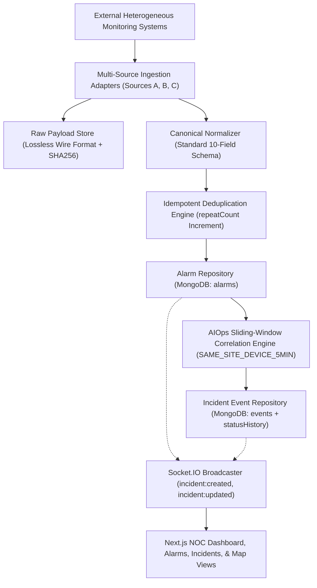

# App360 – Enterprise Network Monitoring & Alarm Correlation System

A production-grade, enterprise-ready Network Operations Center (NOC) application aligned with the **App360 Architecture** (Data Layer, Business Logic Layer, Presentation Layer, Agentic-ready design) featuring:
- **Configurable Database-Driven RBAC**: Admin, Engineer, Viewer with per-module permissions across 9 system modules.
- **AIOps-Inspired Rule-Based Alarm Correlation Engine**: Multi-source ingestion, schema normalization, sliding 5-minute time-window correlation, grouped events, and raw wire drill-down.
- **Real-Time Full-Duplex Socket.IO Infrastructure**: Instant broadcasting of newly ingested alarms, correlated incident creations, lifecycle status transitions, and cartographic updates.
- **Incident Lifecycle Management**: Full state machine (Open → Acknowledged → Resolved ↔ Reopened) with complete chronological operator status audit history.
- **Dynamic Operator Permission Matrix**: Real-time permission inspection by Role or by Operator (including dynamically registered operators like Suganthan).
- **Interactive Cartographic Network Topology Map**: React Leaflet GIS map with dynamic worst-case severity color rollups, regional clustering, and node drawers.
- **Multi-Source External Ingestion Pipeline**: Ingestion adapters for Source A (SolarWinds legacy), Source B (OpenNMS incidents), and Source C (Agent metrics), with SHA-256 wire checksums and raw payload audit preservation.
- **Strict Layered Separation**: Presentation (Next.js 14 App Router), Business Logic (Express Services, Correlation, Ingestion, WebSocket Broadcaster), Data Layer (Mongoose Repositories, MongoDB).

---

## System Health & Test Verification Summary

- **Total Automated Test Suites**: 8 / 8 Passing
- **Total Automated Assertions**: 185 / 185 Passing (100%)
- **Frontend Production Build**: 16 / 16 Routes Compiled Cleanly (0 Errors, 0 Warnings)
- **Master Documentation**: See [`docs/master-architecture-and-delivery.md`](docs/master-architecture-and-delivery.md) for full 17-section architectural report and Requirements Traceability Matrix.

---

## Technology Stack

- **Frontend**: Next.js 14 (App Router) + TypeScript + Tailwind CSS + Lucide Icons
- **Backend**: Node.js + Express.js + Socket.IO + Mongoose
- **Database**: MongoDB Community Server (`mongodb://127.0.0.1:27017/app360`)
- **Authentication**: JWT (JSON Web Tokens) Bearer auth & bcryptjs (Salt rounds: 12)
- **Validation**: Zod schema validation & Canonical Alarm Normalizer
- **Mapping**: React Leaflet + OpenStreetMap
- **Scheduling**: node-cron (automated background telemetry polling)
- **Deployment Packaging**: Zoho Catalyst AppSail & Serverless Client (`catalyst.json`)

---

## Architectural Data Flow Pipeline



---

## Quick Start & Local Execution

### 1. Prerequisites
- Node.js 18.x, 20.x, or 22.x
- MongoDB running on `127.0.0.1:27017`

### 2. Start Backend API & Socket.IO Engine
```bash
cd backend
npm install
npm run dev
```
*Backend runs on `http://localhost:5000`.*

### 3. Start Frontend NOC Dashboard
```bash
cd frontend
npm install
npm run dev
```
*Frontend runs on `http://localhost:3000`.*

### 4. Default Seeded Credentials
| Role | Email Address | Password | Permissions |
|---|---|---|---|
| **ADMIN** | `admin@app360.internal` | `Admin@360!` | Universal Read/Write across all 9 modules |
| **ENGINEER** | `engineer.test@app360.internal` | `Password123!` | Operational access (Alarms, Events, Maps, Ingestion) |
| **VIEWER** | `viewer.test@app360.internal` | `Password123!` | Read-only access (Dashboards, Alarms, Topology) |

---

## Running Verification Test Suites

```bash
# Run all 8 backend test suites (185 assertions)
npm --prefix backend run test:all

# Run master end-to-end integration suite (69 assertions)
npm --prefix backend run test:master

# Verify frontend types and production build
npm --prefix frontend run lint
npm --prefix frontend run build
```
