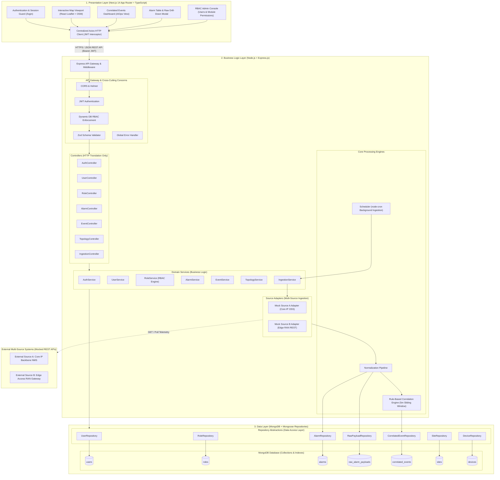
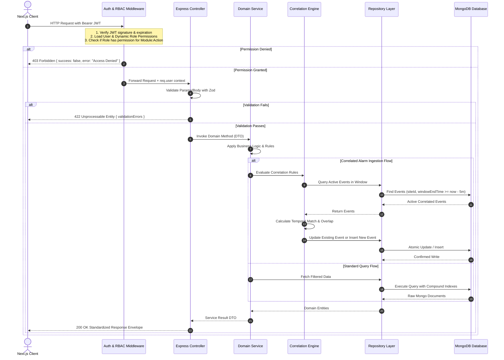
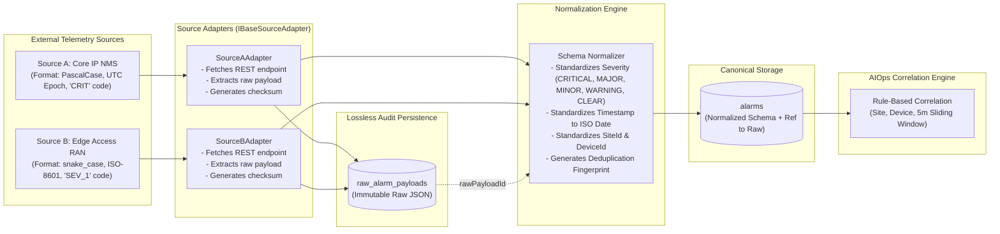
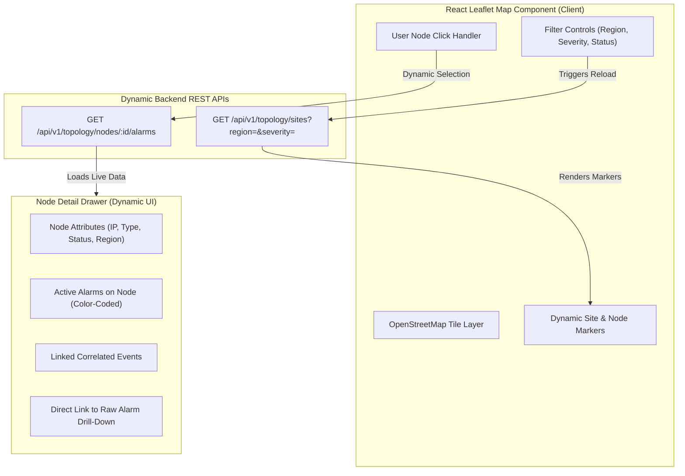
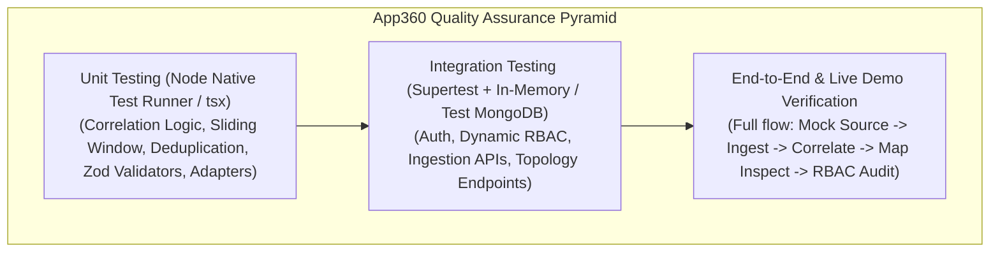
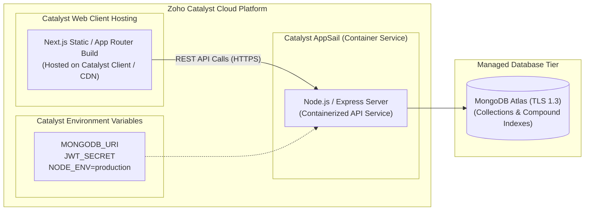

# App360 System Architecture & Technical Design Document

> **Document Version:** 1.0.0  
> **Target Audience:** Engineering Leadership, Full Stack Engineers, AIOps Architects, QA Engineers  
> **Status:** Architecture Proposal – Awaiting Review & Approval  

---

## Table of Contents
1. [Executive Summary & Architectural Paradigm](#1-executive-summary--architectural-paradigm)
2. [End-to-End System Architecture (Mermaid)](#2-end-to-end-system-architecture-mermaid)
3. [Three-Tier Layer Responsibilities](#3-three-tier-layer-responsibilities)
4. [Controller-Service-Repository Request Flow](#4-controller-service-repository-request-flow)
5. [Frontend Module Architecture](#5-frontend-module-architecture)
6. [Backend Module Architecture](#6-backend-module-architecture)
7. [External Multi-Source Ingestion Pipeline](#7-external-multi-source-ingestion-pipeline)
8. [Periodic Ingestion & Concurrency Control](#8-periodic-ingestion--concurrency-control)
9. [Interactive Map Architecture](#9-interactive-map-architecture)
10. [Security Strategy & Dynamic RBAC Enforcement](#10-security-strategy--dynamic-rbac-enforcement)
11. [Centralized Error Handling Strategy](#11-centralized-error-handling-strategy)
12. [Testing Strategy](#12-testing-strategy)
13. [Deployment Architecture for Zoho Catalyst](#13-deployment-architecture-for-zoho-catalyst)
14. [Assignment Requirement Traceability Matrix](#14-assignment-requirement-traceability-matrix)
15. [Assumptions & Technical Risk Mitigation](#15-assumptions--technical-risk-mitigation)

---

## 1. Executive Summary & Architectural Paradigm

**App360** is a carrier-grade Network Monitoring and Alarm Management System built upon an **Agentic-ready, AIOps-aligned three-tier architecture**. In modern telecommunications and mission-critical network environments, raw alarms generate massive operational noise ("alarm storms") during cascading infrastructure failures. App360 resolves this by ingesting multi-source telemetry, normalizing heterogeneous schemas into a canonical internal standard, correlating alarms using rule-based spatial and temporal heuristics, and rendering live topology visualizations on an interactive map.

### Key Architectural Pillars
- **Strict Layer Decoupling**: Complete segregation between Presentation (Next.js), Business Logic (Express.js), and Data Persistence (MongoDB/Mongoose via Repositories). Zero client-to-database connections.
- **Dynamic Database-Driven RBAC**: Permissions are not hardcoded in source code; they are dynamically defined in MongoDB collections per module (`ALARM`, `MAP`, `API`, `USER_MANAGEMENT`) and evaluated at runtime by backend middleware before reaching business services.
- **AIOps-Inspired Temporal-Topological Correlation**: Rule-based reasoning evaluating same site, same device, sliding 5-minute time windows, overlapping window elongation, fingerprint deduplication, and automated root cause heuristics.
- **Lossless Ingestion Pipeline**: Full raw telemetry payload audit preservation (`raw_alarm_payloads`) allowing engineers to drill down from high-level correlated incidents to exact raw wire payloads.
- **Dynamic Map Topology**: Dynamic marker selection and viewport queries where map interaction triggers backend REST endpoints for live device telemetry and alarm rollups.

---

## 2. End-to-End System Architecture (Mermaid)



---

## 3. Three-Tier Layer Responsibilities

| Layer | Component | Core Responsibilities | Prohibited Actions |
| :--- | :--- | :--- | :--- |
| **Presentation Layer** | Next.js (App Router), Tailwind CSS, React Leaflet | • User authentication state and session caching.<br>• Dynamic UI rendering based on RBAC permissions.<br>• Interactive network map display (Leaflet/OSM).<br>• Node selection triggering live backend REST API calls.<br>• Visualizing correlated events and raw alarm drill-down modal.<br>• Client-side route protection. | • **Never** connect directly to MongoDB.<br>• **Never** perform alarm correlation client-side.<br>• **Never** make final authorization decisions (UI gating is UX only).<br>• **Never** expose secrets/keys. |
| **Business Logic Layer** | Express.js, Controllers, Services, Correlation Engine, Adapters, Scheduler | • Intercept HTTP requests and authenticate Bearer JWT.<br>• Query dynamic DB-backed role permissions to enforce RBAC.<br>• Validate incoming request payloads with Zod schemas.<br>• Coordinate source adapters to fetch multi-source telemetry.<br>• Normalize heterogeneous schemas into canonical internal format.<br>• Execute rule-based alarm correlation (5-min sliding window, site/device matching, overlapping window elongation, deduplication).<br>• Manage cron-based background ingestion jobs. | • **Never** embed raw SQL/Mongoose query syntax in Controllers.<br>• **Never** bypass normalization before correlation.<br>• **Never** discard raw telemetry payloads.<br>• **Never** hardcode permission decisions in if/else blocks without DB consultation. |
| **Data Layer** | Repositories, Mongoose Models, MongoDB Collections | • Define strictly typed Mongoose schemas and compound indexes.<br>• Encapsulate all database queries, mutations, atomic transactions, and aggregation pipelines.<br>• Enforce referential integrity and uniqueness constraints (e.g., duplicate alarm fingerprint, user emails).<br>• Abstract database implementation details from domain services. | • **Never** leak database connection handles or raw Mongoose cursors directly to HTTP responses.<br>• **Never** execute business rules or correlation heuristics inside repositories. |

---

## 4. Controller-Service-Repository Request Flow

The architecture enforces a strict unidirectional request-response flow:



---

## 5. Frontend Module Architecture

The frontend is structured within Next.js 14 App Router with clean separation between pages, UI components, custom hooks, and API clients:

```
client/
├── public/                         # Static assets (markers, icons, logos)
├── src/
│   ├── app/                        # Next.js App Router Structure
│   │   ├── (auth)/                 # Public Auth Group
│   │   │   └── login/
│   │   │       └── page.tsx        # Login interface with error handling
│   │   ├── (dashboard)/            # Authenticated App Layout & Guard
│   │   │   ├── layout.tsx          # Nav header, sidebar, session wrapper
│   │   │   ├── map/
│   │   │   │   └── page.tsx        # Interactive Map Viewport & Filter Panel
│   │   │   ├── events/
│   │   │   │   └── page.tsx        # AIOps Correlated Events View & Timeline
│   │   │   ├── alarms/
│   │   │   │   └── page.tsx        # Raw & Normalized Alarm Explorer
│   │   │   └── admin/              # RBAC Restricted Admin Routes
│   │   │       ├── users/
│   │   │       │   └── page.tsx    # User Management (Create, Assign Roles)
│   │   │       └── roles/
│   │   │           └── page.tsx    # Module-Level Permission Configuration
│   │   ├── globals.css             # Tailwind CSS imports & map styling
│   │   ├── layout.tsx              # Root HTML wrapper
│   │   └── page.tsx                # Redirect to /map or /login
│   ├── components/                 # Reusable UI Components
│   │   ├── common/                 # Buttons, Badges, Modals, Loaders
│   │   ├── map/                    # Leaflet Map, Node Markers, Topology Filter
│   │   ├── alarms/                 # Alarm Table, Severity Badges, Raw Data Modal
│   │   ├── events/                 # Correlated Event Card, Root Cause Badge, Drill-down
│   │   └── admin/                  # Permission Matrix Table, User Form
│   ├── context/                    # React Context Providers
│   │   └── AuthContext.tsx         # User profile, JWT token, permissions matrix
│   ├── hooks/                      # Custom React Hooks
│   │   ├── useAlarms.ts            # SWR / Axios alarm polling & filtering
│   │   ├── useCorrelatedEvents.ts  # Correlated events data fetcher
│   │   ├── useTopology.ts          # Sites, nodes, and live node alarm stats
│   │   └── usePermissions.ts       # Utility to check user permission for UI gating
│   ├── services/                   # Frontend API Client
│   │   ├── api.ts                  # Axios instance with Bearer interceptors
│   │   ├── auth.service.ts         # Login, logout, fetch current user
│   │   ├── alarm.service.ts        # Alarms & raw payload retrieval
│   │   ├── event.service.ts        # Correlated events retrieval & updates
│   │   ├── topology.service.ts     # Sites, nodes, dynamic node selection
│   │   └── admin.service.ts        # Users, roles, permission matrix updates
│   └── types/                      # TypeScript Frontend Interfaces
│       ├── auth.ts                 # User, Role, ModulePermission
│       ├── alarm.ts                # NormalizedAlarm, RawPayload, Severity
│       ├── event.ts                # CorrelatedEvent, RootCauseHeuristic
│       └── topology.ts             # Site, Node, GeoCoordinates, Status
```

---

## 6. Backend Module Architecture

The backend is developed in Node.js + Express with TypeScript, strictly adhering to the layered architectural pattern:

```
server/
├── src/
│   ├── common/                     # Cross-Cutting Core Utilities
│   │   ├── errors/                 # AppError, BadRequestError, UnauthorizedError, etc.
│   │   ├── utils/                  # Response wrapper, logger, hash utilities
│   │   └── constants/              # Enums (Severity, Status, Modules, Actions)
│   ├── config/                     # Configuration Management
│   │   ├── env.ts                  # Zod validated environment variables
│   │   └── database.ts             # Mongoose connection & lifecycle handlers
│   ├── database/                   # Mongoose Schemas & Models
│   │   ├── schemas/                # UserSchema, RoleSchema, AlarmSchema, etc.
│   │   └── models/                 # UserModel, RoleModel, AlarmModel, etc.
│   ├── repositories/               # Data Access Layer (Repositories)
│   │   ├── base.repository.ts      # Generic IBaseRepository<T> & BaseRepository<T>
│   │   ├── user.repository.ts      # User queries & role population
│   │   ├── role.repository.ts      # Role & dynamic permission queries
│   │   ├── site.repository.ts      # Site topology queries
│   │   ├── device.repository.ts    # Device topology & status queries
│   │   ├── alarm.repository.ts     # Normalized alarm queries, deduplication lookup
│   │   ├── raw-payload.repository.ts # Immutable raw JSON storage
│   │   └── event.repository.ts     # Correlated event matching & temporal queries
│   ├── middleware/                 # Express Request Middleware
│   │   ├── auth.middleware.ts      # JWT verification & request attachment
│   │   ├── rbac.middleware.ts      # Dynamic DB-driven permission checking
│   │   ├── validate.middleware.ts  # Zod schema validation interceptor
│   │   └── error.middleware.ts     # Global exception & error response handler
│   ├── modules/                    # Domain Modules (Controller + Service)
│   │   ├── auth/                   # Login, Me, Token refresh
│   │   ├── users/                  # User CRUD & role assignment
│   │   ├── roles/                  # Role CRUD & dynamic permission matrix
│   │   ├── alarms/                 # Alarm querying & raw drill-down
│   │   ├── correlation/            # Correlation rules engine & event querying
│   │   ├── topology/               # Sites, nodes, dynamic node alarm summary
│   │   └── ingestion/              # Multi-source adapters & pipeline orchestrator
│   ├── jobs/                       # Background Schedulers
│   │   └── ingestion.job.ts        # node-cron scheduled ingestion runner
│   ├── app.ts                      # Express application composition & route registry
│   └── server.ts                   # HTTP server bootstrap & DB initialization
└── tests/                          # Automated Integration & Unit Tests
```

---

## 7. External Multi-Source Ingestion Pipeline

To satisfy the requirement of simulating multi-source API ingestion, the backend implements the **Adapter Pattern**:



### Normalization Mapping Example

| Target Canonical Field | Source A (Core IP NMS) | Source B (Edge RAN Gateway) | Canonical Transformation Rule |
| :--- | :--- | :--- | :--- |
| `sourceId` | Hardcoded: `"SOURCE_A_CORE_NMS"` | Hardcoded: `"SOURCE_B_EDGE_RAN"` | Identifies provenance |
| `sourceAlarmId` | `item.AlarmIdentifier` | `item.alert_id` | Preserved external ID |
| `siteId` | `item.StationCode` | `item.location.site_tag` | Uppercase, trim whitespace |
| `deviceId` | `item.DeviceHostname` | `item.equipment_id` | Uppercase, trim whitespace |
| `severity` | `100` $\rightarrow$ `CRITICAL`<br>`200` $\rightarrow$ `MAJOR`<br>`300` $\rightarrow$ `MINOR`<br>`400` $\rightarrow$ `WARNING` | `"FATAL"` $\rightarrow$ `CRITICAL`<br>`"HIGH"` $\rightarrow$ `MAJOR`<br>`"MED"` $\rightarrow$ `MINOR`<br>`"LOW"` $\rightarrow$ `WARNING` | Standard 5-level enum: `CRITICAL`, `MAJOR`, `MINOR`, `WARNING`, `CLEAR` |
| `alarmType` | `item.AlarmName` | `item.event_category` | Normalized snake/upper case string |
| `description` | `item.SummaryText` | `item.details.message` | Clean string |
| `occurredAt` | Unix epoch milliseconds (`item.EpochTimestamp`) | ISO 8601 string (`item.timestamp_utc`) | Standard JavaScript `Date` object |
| `fingerprint` | Computed SHA-256 hash | Computed SHA-256 hash | `SHA256(sourceId:deviceId:alarmType:occurredAtWindow)` |

---

## 8. Periodic Ingestion & Concurrency Control

The ingestion engine is executed via two pathways:
1. **Periodic Scheduler (`node-cron`)**: Defaults to running every 60 seconds (`*/1 * * * *`), configurable via `INGESTION_CRON` environment variable.
2. **On-Demand Manual Trigger (`POST /api/v1/ingestion/trigger`)**: Allows operators or automated tests to execute an immediate ingestion cycle.

### Concurrency Lock / Mutex Protection
To prevent race conditions and duplicate processing when an ingestion cycle exceeds the cron frequency:
- An in-memory distributed atomic lock flag (`isIngestionRunning`) guards execution.
- If a scheduled trigger fires while a previous cycle is in progress, the cycle is safely skipped and logged: `"Ingestion cycle skipped: prior batch still executing"`.
- Each ingestion run generates an `ingestionBatchId` (UUID) tracked in an audit log with duration, items ingested, duplicates suppressed, and correlated events updated.

---

## 9. Interactive Map Architecture

The interactive map is implemented with **React Leaflet** using **OpenStreetMap** tiles, engineered specifically for high-performance network topology monitoring:



### Status & Color Indicators
Every site and node marker visually indicates network health through dynamic severity rollups:
- **Red (`CRITICAL`)**: At least one active `CRITICAL` alarm or open critical correlated event on the site/device.
- **Yellow (`MAJOR` / `MINOR` / `WARNING`)**: At least one active major, minor, or warning alarm, with no critical alarms present.
- **Green (`CLEAR` / `NORMAL`)**: All alarms cleared or zero active alarms detected.

### Dynamic Backend Querying
Marker selection is **strictly dynamic**: clicking a map node does not rely on stale client cache. It immediately dispatches `GET /api/v1/topology/nodes/:id/alarms` to retrieve real-time active alarms, active correlated incidents, and telemetry history for that specific node.

---

## 10. Security Strategy & Dynamic RBAC Enforcement

### Authentication Flow
- **Standard**: JSON Web Token (JWT) signed with HMAC-SHA256 (`HS256`).
- **Secrets**: Configured through `JWT_SECRET` environment variable; minimum 32 characters; rejected on startup if insecure.
- **Password Protection**: Passwords salted and hashed with `bcryptjs` (work factor 12). Plaintext passwords are never logged, stored, or returned in any API response (`select: false` on Mongoose schema).
- **Transport**: Bearer authentication header (`Authorization: Bearer <token>`).

### Dynamic Database-Driven RBAC Permission Model
Authorization is **never hardcoded** with static `if (role === 'Admin')` checks. Instead, roles and module permissions are persisted in MongoDB.

#### Module & Action Definitions
- **Modules**: `ALARM`, `MAP`, `API`, `USER_MANAGEMENT`
- **Actions**: `READ`, `CREATE`, `UPDATE`, `DELETE`, `EXECUTE`

#### Out-of-the-Box Role Permission Matrix

| Module | Action | Admin Role | Engineer Role | Viewer Role |
| :--- | :--- | :---: | :---: | :---: |
| **ALARM** | `READ` | ✅ Allowed | ✅ Allowed | ✅ Allowed |
| **ALARM** | `UPDATE` (Acknowledge / Resolve) | ✅ Allowed | ✅ Allowed | ❌ Forbidden |
| **ALARM** | `DELETE` (Purge) | ✅ Allowed | ❌ Forbidden | ❌ Forbidden |
| **MAP** | `READ` (View Topology & Status) | ✅ Allowed | ✅ Allowed | ✅ Allowed |
| **MAP** | `UPDATE` (Update Site / Device) | ✅ Allowed | ❌ Forbidden | ❌ Forbidden |
| **API** | `READ` (View Ingestion Status) | ✅ Allowed | ✅ Allowed | ❌ Forbidden |
| **API** | `EXECUTE` (Trigger Manual Ingestion) | ✅ Allowed | ✅ Allowed | ❌ Forbidden |
| **USER_MANAGEMENT** | `READ` (List Users & Roles) | ✅ Allowed | ❌ Forbidden | ❌ Forbidden |
| **USER_MANAGEMENT** | `CREATE` / `UPDATE` / `DELETE` | ✅ Allowed | ❌ Forbidden | ❌ Forbidden |

#### Backend Middleware Enforcement
Before any controller route executes, the middleware verifies:
```typescript
authorize(Module.ALARM, Action.UPDATE)
```
1. Reads `req.user.roleId` populated by `authMiddleware`.
2. Queries the populated `Role` document (or cached role definition).
3. Verifies whether `permissions` contains `{ module: 'ALARM', actions: { $in: ['UPDATE'] } }`.
4. If missing, immediately halts request and returns `403 Forbidden` with `{ success: false, error: "Insufficient permissions for module ALARM with action UPDATE" }`.

---

## 11. Centralized Error Handling Strategy

### Error Hierarchy
All system errors inherit from a base `AppError` class:
```typescript
export class AppError extends Error {
  constructor(
    public readonly message: string,
    public readonly statusCode: number = 500,
    public readonly code: string = 'INTERNAL_ERROR',
    public readonly details: any = null,
    public readonly isOperational: boolean = true
  ) {
    super(message);
    Object.setPrototypeOf(this, new.target.prototype);
  }
}
```

Derived classes:
- `BadRequestError` (400, `BAD_REQUEST`)
- `UnauthorizedError` (401, `UNAUTHORIZED`)
- `ForbiddenError` (403, `FORBIDDEN`)
- `NotFoundError` (404, `NOT_FOUND`)
- `ConflictError` (409, `CONFLICT`)
- `ValidationError` (422, `VALIDATION_ERROR`)
- `RateLimitError` (429, `RATE_LIMIT_EXCEEDED`)

### Standard API Response Envelope
Every API response strictly follows a uniform JSON structure:

#### Success Response
```json
{
  "success": true,
  "data": { ... },
  "meta": {
    "page": 1,
    "limit": 20,
    "total": 142,
    "totalPages": 8
  },
  "timestamp": "2026-11-11T09:30:00.000Z"
}
```

#### Error Response
```json
{
  "success": false,
  "error": {
    "code": "FORBIDDEN",
    "message": "User lacks permission to execute manual ingestion",
    "details": null,
    "timestamp": "2026-11-11T09:30:00.000Z"
  }
}
```

---

## 12. Testing Strategy

The verification strategy guarantees system reliability across every layer:



1. **Unit Tests**:
   - Correlation Engine: 5-minute sliding window match, device match, site match, overlapping window extension, duplicate fingerprint suppression, root cause classification.
   - Normalizers: Source A & Source B transformation into canonical schema.
   - Zod Validators: Input schemas for auth, users, and ingestion triggers.
2. **Integration Tests**:
   - Authentication & JWT issuance.
   - RBAC enforcement: Admin vs. Engineer vs. Viewer accessing protected routes.
   - Ingestion API: Full cycle writing raw payloads, creating normalized alarms, updating correlated events.
   - Map APIs: Filtering by region and severity, dynamic node alarm count verification.
3. **End-to-End Simulation**:
   - Seed script creating realistic telecom network (5 sites, 25 devices, mock core and edge sources).
   - Simulating an upstream fiber cut generating an alarm storm; verifying that the correlation engine groups 15 alarms into a single incident and points to the root cause.

---

## 13. Deployment Architecture for Zoho Catalyst

App360 is designed for clean deployment onto **Zoho Catalyst**:



### Catalyst Configuration (`catalyst.json`)
The deployment defines an **AppSail** instance for the Express backend and **Client** hosting for the Next.js frontend:
```json
{
  "client": {
    "source": "client/out"
  },
  "appsail": [
    {
      "name": "app360-api",
      "source": "server",
      "build": "npm run build",
      "run": "node dist/server.js",
      "env_variables": {
        "NODE_ENV": "production",
        "PORT": "8080"
      }
    }
  ]
}
```

---

## 14. Assignment Requirement Traceability Matrix

Every single user story and requirement from `App360_User_Story.docx` is mapped directly to our proposed technical implementation:

| Requirement Area | User Story / Constraint | Architectural Implementation & Location |
| :--- | :--- | :--- |
| **Layered Architecture** | Must follow Data Layer, Business Logic Layer, Presentation Layer | • Presentation: `client/` (Next.js)<br>• Business: `server/src/services/`, `server/src/modules/`<br>• Data: `server/src/repositories/`, `server/src/database/` |
| **Direct DB Rule** | Frontend must consume backend via API only (no direct DB access) | Next.js uses Axios to communicate with Express REST API. Zero Mongoose or Mongo driver code in `client/`. |
| **Layer Decoupling** | Separate Controller, Service, and Repository | Explicit `BaseController`, `BaseService`, `BaseRepository` classes in `server/src/` ensuring separation of concerns. |
| **RBAC Roles** | Admin can create users and assign roles (Admin, Engineer, Viewer) | `server/src/modules/users/` and `server/src/modules/roles/` endpoints protected by Admin RBAC; Next.js `/admin/users` UI. |
| **Configurable Permissions** | Admin can configure permissions per module (Alarm, Map, API) | Permissions stored in MongoDB `roles` collection. Dynamic matrix UI in Next.js `/admin/roles`; zero hardcoded role checks. |
| **Multi-Role Enforcement** | Backend API-level enforcement reflecting in frontend UI | `rbac.middleware.ts` validates module and action at route level; React `usePermissions()` hides/disables unauthorized UI elements. |
| **Alarm Ingestion** | Ingest alarms from multiple sources (mock REST API) | Source Adapters (`SourceAAdapter`, `SourceBAdapter`) fetching from mock endpoints in `server/src/modules/ingestion/`. |
| **Data Normalization** | Normalize raw alarm data before processing | `NormalizationEngine` transforms multi-source formats to canonical `Alarm` schema. |
| **Lossless Audit** | Drill-down to raw alarm details; preserve raw data | Immutable `raw_alarm_payloads` collection stores raw wire JSON. Alarm points to `rawPayloadId`. API `GET /api/v1/alarms/:id/raw`. |
| **Alarm Correlation** | Correlate alarms by same site, device, 5m time window | `CorrelationEngine` implements temporal sliding window ($\Delta t \le 300\text{s}$) with site/device matching. |
| **Grouped Events** | View correlated alarms as grouped events | `correlated_events` collection grouping constituent alarms with root cause heuristic and severity rollup. |
| **Interactive Map** | Interactive network topology map | Next.js `React-Leaflet` + OpenStreetMap component at `/map`. |
| **Dynamic Marker Calls** | Map interaction triggers backend API calls dynamically | Clicking node executes `GET /api/v1/topology/nodes/:id/alarms` fetching live alarms and correlated incidents. |
| **Map Severity Coding** | Status indicators (green/yellow/red) based on severity | Dynamic severity rollups: Red = Critical, Yellow = Major/Minor/Warning, Green = Clear. |
| **Map Filtering** | Filter nodes by severity/region/status | Next.js filter toolbar bound to dynamic backend query parameters `GET /api/v1/topology/nodes?region=&severity=`. |
| **Periodic Refresh** | Streaming or periodic refresh simulation | `node-cron` background scheduler running every 60 seconds with mutex concurrency lock + manual trigger API. |
| **Deployment Target** | Zoho Catalyst support | Catalyst `catalyst.json` AppSail and Client hosting configuration. |

---

## 15. Assumptions & Technical Risk Mitigation

| Risk / Assumption | Potential Impact | Architectural Mitigation |
| :--- | :--- | :--- |
| **Alarm Storm Ingestion Spike** | Memory exhaustion or event loop blocking during high-volume alarm influx. | Ingestion operates in batches with bounded concurrency; raw payloads saved asynchronously; compound indexing prevents full collection scans. |
| **Sliding Time Window Boundary Shifts** | An alarm arriving slightly late could cause split events or missed correlations. | The correlation engine uses a **sliding window extension**: each new matching alarm resets the event's `windowEndTime = newAlarmTime + 5m` up to a max duration cap (2 hours). |
| **Overlapping Concurrency in Cron** | Multiple cron executions overlapping if network telemetry fetch lags. | In-memory atomic mutex lock (`isIngestionRunning`) prevents concurrent cycles; subsequent triggers are safely logged and skipped until completion. |
| **Network Node Scale on Map** | Rendering thousands of SVG markers degrading browser rendering performance. | Leaflet marker clustering and bounding-box / region filtering to fetch only nodes relevant to the active viewport. |
| **RBAC Security Bypass Attempt** | Malicious users forging client requests or tampering with token payload. | Cryptographic verification of JWT on every request; permissions re-verified against live database records; no reliance on client state. |

