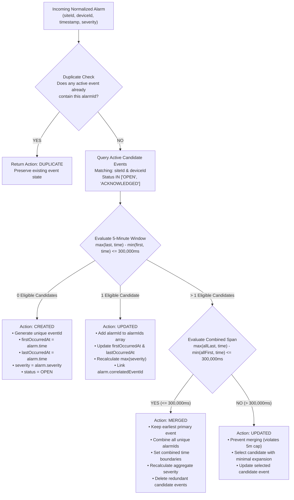
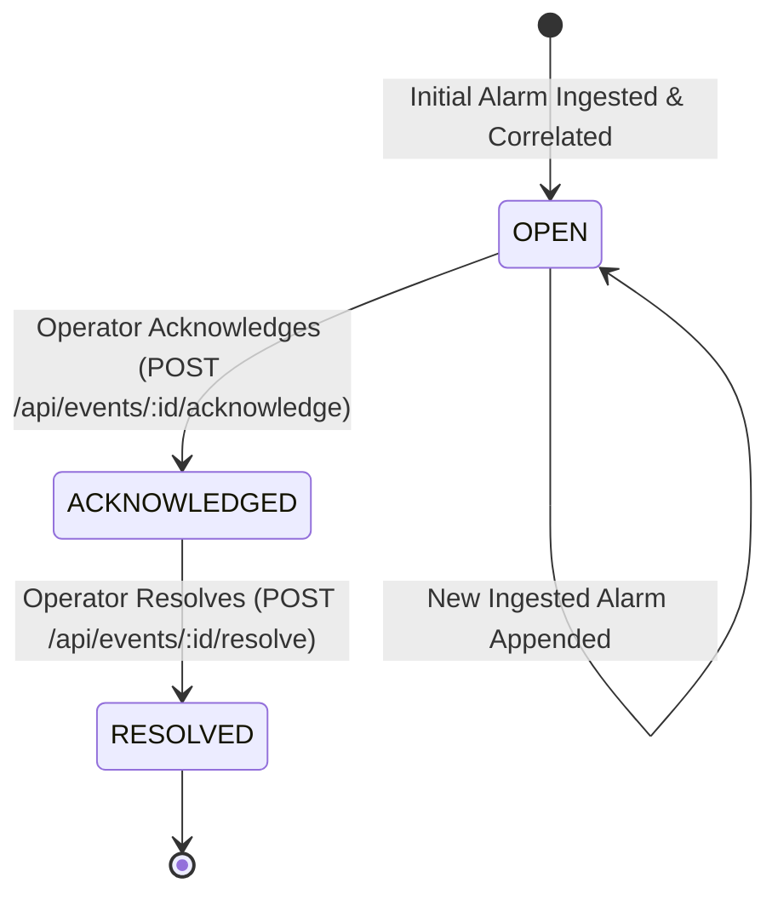

# App360 AIOps Alarm Correlation Engine Specification

> **Document Version:** 2.0.0  
> **Module:** Correlation Engine (`backend/src/services/correlationService.js`)  
> **Architecture Layer:** Business Logic Layer  
> **Concept:** AIOps Temporal & Topological Heuristic Event Aggregation  

---

## 1. Executive Summary & Correlation Philosophy

In modern telecommunication networks, distributed IP backbones, and enterprise cloud data centers, a single root fault (such as a core link failure, power disruption, or BGP flap) cascades rapidly, triggering dozens or hundreds of downstream symptomatic alarms across switches, routers, firewalls, and edge nodes within seconds. This alert storm overwhelms Network Operations Center (NOC) engineers.

**App360** implements a carrier-grade, rule-based **AIOps Alarm Correlation Engine** designed to:
1. **Eliminate Redundant Alerts:** Suppress duplicate incoming alerts via cryptographic fingerprinting and compound index tracking.
2. **Topological Coalescence:** Isolate alarms strictly by physical site (`siteId`) and physical device (`deviceId`).
3. **Strict 5-Minute Time-Window Boundary:** Enforce a strict non-rolling $\le 5\text{-minute}$ ($300,000\text{ ms}$) boundary between the earliest and latest constituent alarms:
   $$\max(\text{lastOccurredAt}, T_{\text{alarm}}) - \min(\text{firstOccurredAt}, T_{\text{alarm}}) \le 300,000\text{ ms}$$
4. **Overlapping Event Merging:** Automatically merge multiple active candidate events into a single unified event when their combined time span satisfies the 5-minute rule ($\le 300,000\text{ ms}$).
5. **Selective Minimal Expansion:** When multiple candidate events match but their combined span exceeds 5 minutes, prevent invalid merging and assign the alarm to the candidate with the minimal temporal expansion.
6. **Dynamic Severity Escalation:** Dynamically escalate the event severity to the highest severity among all active constituent alarms (`CRITICAL` > `MAJOR` > `MINOR` > `WARNING` > `INFO`).
7. **Lossless Forensic Drill-Down:** Retain full referential integrity from Correlated Events $\rightarrow$ Constituent Alarms $\rightarrow$ Raw Wire JSON Payloads (`raw_alarm_payloads`).

---

## 2. Correlation Engine Architecture & Flow

---

## 3. Mandatory Correlation Rule Specifications

### 3.1. Same Site Isolation
- **Rule:** Alarms must match `siteId` (case-insensitive string comparison).
- **Behavior:** An alarm for device `RTR001` at site `TRY001` will **never** correlate into an active event for `RTR001` at site `CHN001`. Different sites represent distinct geographical facilities and must be isolated.

### 3.2. Same Device Isolation
- **Rule:** Alarms must match `deviceId` (case-insensitive string comparison).
- **Behavior:** An alarm for device `RTR002` at site `CHN001` will **never** correlate into an active event for device `RTR001` at site `CHN001`. Equipment instances are distinct operational entities.

### 3.3. Strict 5-Minute Non-Rolling Window ($\Delta t \le 300,000\text{ ms}$)
- **Mathematical Formula:**
  $$\text{Span} = \max(\text{event.lastOccurredAt}, T_{\text{alarm}}) - \min(\text{event.firstOccurredAt}, T_{\text{alarm}})$$
- **Boundary Conditions:**
  - $\text{Span} \le 300,000\text{ ms}$: The alarm joins the event (`UPDATED`).
  - $\text{Span} = 300,000\text{ ms}$ (exactly 5 minutes): The alarm joins the event.
  - $\text{Span} > 300,000\text{ ms}$ (e.g., $300,001\text{ ms}$): The alarm **cannot** join the event. A separate event is created.
- **Prohibition of Rolling Window Elongation:** Unlike naive sliding windows that allow events to extend infinitely (e.g., 10:00 $\rightarrow$ 10:04 $\rightarrow$ 10:08 $\rightarrow$ 10:12 into a 12-minute single event), App360 strictly requires that the difference between the **absolute earliest alarm** and the **absolute latest alarm** in an event never exceeds 5 minutes ($300,000\text{ ms}$).

### 3.4. Overlapping Candidate Merging vs. Selective Join
When an incoming alarm bridges two or more active candidate events on the same site and device:
1. **Full Merge Condition:**
   $$\max(\{T_{\text{last}, i}\}, T_{\text{alarm}}) - \min(\{T_{\text{first}, i}\}, T_{\text{alarm}}) \le 300,000\text{ ms}$$
   If the entire combined span is within 5 minutes:
   - The candidate with the earliest `firstOccurredAt` is retained as the `primaryEvent`.
   - All unique `alarmIds` from all candidate events and the new alarm are merged into `primaryEvent.alarmIds`.
   - The secondary events are deleted from the database.
   - The result is `{ action: 'MERGED', event: primaryEvent }`.
2. **Prevented Merge (Selective Join):**
   If the combined span exceeds 5 minutes ($> 300,000\text{ ms}$), merging all candidates would violate the 5-minute rule. Therefore:
   - Merging is aborted.
   - The candidate event whose time span expands the least ($\min(\Delta \text{span})$) is updated with the new alarm.
   - The other candidate event remains independent.

### 3.5. Duplicate Alarm Idempotency
- If `event.alarmIds` already contains `alarm._id`, the engine recognizes the alarm as a duplicate:
  - Returns `{ action: 'DUPLICATE', event }`.
  - Does not mutate `alarmIds` or recalculate severity.
  - Guarantees idempotent reprocessing during batch reconciliation or network retries.

### 3.6. Dynamic Severity Hierarchy & Escalation
- **Hierarchy Order:**
  $$\text{CRITICAL (5)} > \text{MAJOR (4)} > \text{MINOR (3)} > \text{WARNING (2)} > \text{INFO (1)}$$
- **Dynamic Recalculation:**
  $$\text{event.severity} = \max_{a \in \text{alarmIds}}(\text{severity}(a))$$
  When a higher-severity alarm arrives (e.g., `CRITICAL` arrives in an event that was previously `WARNING`), the event immediately escalates to `CRITICAL`.
  When alarms are cleared or removed, `calculateAggregateSeverity` re-evaluates the highest active severity.

### 3.7. Out-of-Order Alarm Arrival Handling
- Telemetry networks often transmit alarms via asynchronous paths with out-of-order latency.
- If an alarm arrives with a timestamp earlier than `event.firstOccurredAt`:
  $$\text{event.firstOccurredAt} = \min(\text{event.firstOccurredAt}, T_{\text{alarm}})$$
- Similarly, if an alarm arrives with a timestamp later than `event.lastOccurredAt`:
  $$\text{event.lastOccurredAt} = \max(\text{event.lastOccurredAt}, T_{\text{alarm}})$$
- Both boundaries are accurately preserved regardless of ingestion order.

---

## 4. Correlated Event Lifecycle State Machine

### Lifecycle States:
- **`OPEN`:** Default initial state. Actively aggregates new member alarms matching site, device, and temporal criteria.
- **`ACKNOWLEDGED`:** Operator has taken ownership of the incident and provided operational notes. Still capable of receiving correlated alarms if within the 5-minute window.
- **`RESOLVED`:** Incident has been remediated.
  - **Cascading Alarm Sync:** When an event is resolved, all member alarms in `alarmIds` are automatically updated to `status: 'CLEARED'`.
  - Resolved events are excluded from active correlation candidate queries. Any future alarms will initiate a new event.

---

## 5. Correlated Event Data Model (`events` collection)

| Field Name | Type | Constraints / Default | Description |
|---|---|---|---|
| `eventId` | String | Unique, Indexed, Required | Human-readable ID (e.g., `EVT-1718000000000-A1B2C3`) |
| `siteId` | String | Uppercase, Trim, Indexed | Target physical site identifier (e.g., `CHN001`) |
| `deviceId` | String | Uppercase, Trim, Indexed | Target physical device identifier (e.g., `RTR001`) |
| `alarmIds` | `[ObjectId]` | Ref: `Alarm`, Indexed | Array of constituent member alarm ObjectIDs |
| `correlationRule` | String | Default: `'SAME_SITE_DEVICE_5MIN'` | Rule identifier governing the grouping |
| `severity` | String | Enum: `['CRITICAL', 'MAJOR', 'MINOR', 'WARNING', 'INFO']` | Current highest severity among member alarms |
| `status` | String | Enum: `['OPEN', 'ACKNOWLEDGED', 'RESOLVED']` | Current operational lifecycle status |
| `firstOccurredAt` | Date | Required, Indexed | Earliest timestamp among all member alarms |
| `lastOccurredAt` | Date | Required, Indexed | Latest timestamp among all member alarms |
| `notes` | String | Default: `''` | Operator investigation and remediation notes |
| `acknowledgedBy`| `ObjectId` | Ref: `User`, Default: `null` | Operator user who acknowledged the incident |
| `acknowledgedAt`| Date | Default: `null` | Acknowledgment timestamp |
| `resolvedBy` | `ObjectId` | Ref: `User`, Default: `null` | Operator user who resolved the incident |
| `resolvedAt` | Date | Default: `null` | Resolution timestamp |

---

## 6. REST API Endpoints Specification

All endpoints require JWT Bearer token authentication via `Authorization: Bearer <token>`.

### 6.1. Correlated Events Endpoints (`/api/events`)

| Method | Endpoint | Permission Required | Description |
|---|---|---|---|
| `GET` | `/api/events` | `alarm:read` | List correlated events with pagination, status, severity, site, and date filters |
| `GET` | `/api/events/:id` | `alarm:read` | Retrieve specific correlated event details |
| `GET` | `/api/events/:id/alarms` | `alarm:read` | Retrieve constituent alarms and populated raw wire payloads |
| `POST` | `/api/events/:id/acknowledge` | `alarm:update` | Acknowledge event (`OPEN` $\rightarrow$ `ACKNOWLEDGED`) with notes |
| `POST` | `/api/events/:id/resolve` | `alarm:update` | Resolve event (`ACKNOWLEDGED` $\rightarrow$ `RESOLVED`) and clear member alarms |

### 6.2. Correlation Engine Endpoints (`/api/correlation`)

| Method | Endpoint | Permission Required | Description |
|---|---|---|---|
| `GET` | `/api/correlation/stats` | `alarm:read` | Retrieve AIOps noise reduction ratios and event severity distributions |
| `POST` | `/api/correlation/process` | `alarm:update` | Trigger batch correlation scan for unlinked alarms |

---

## 7. Automated Test Suite Verification

The Phase 4 test suite ([`backend/tests/phase4.test.js`](file:///e:/App360/backend/tests/phase4.test.js)) validates 15 deterministic scenarios:

| Test ID | Scenario | Expected Behavior | Result |
|---|---|---|---|
| **Test 1a-d** | Same site, same device, within 5 minutes | First creates event; 2nd & 3rd join; exactly 1 event with 3 alarms | **PASS** |
| **Test 2** | Different site isolation (`TRY001` vs `CHN001`) | Creates separate isolated event; does not join | **PASS** |
| **Test 3** | Different device isolation (`RTR002` vs `RTR001`) | Creates separate isolated event; does not join | **PASS** |
| **Test 4** | Exactly 5-minute boundary ($\Delta t = 300,000\text{ ms}$) | Joins existing event | **PASS** |
| **Test 5** | Boundary $> 5$ minutes ($\Delta t = 301,000\text{ ms}$) | Fails boundary condition; creates new separate event | **PASS** |
| **Test 6a-b** | Duplicate alarm idempotency | Returns `DUPLICATE`; prevents duplicate IDs in `alarmIds` | **PASS** |
| **Test 7** | Out-of-order alarm arrival | Accurately updates `firstOccurredAt` to earlier timestamp | **PASS** |
| **Test 8-9** | Candidate event merging ($\le 5\text{m}$ combined span) | Merges candidate events into primary; all 3 alarms consolidated | **PASS** |
| **Test 10** | Prevent merging when combined span $> 5\text{m}$ | Merging aborted; selective minimal expansion updates 1 candidate | **PASS** |
| **Test 11a-b** | Dynamic severity calculation & escalation | Escalates to `CRITICAL`; aggregate helper selects highest priority | **PASS** |
| **Test 12** | Event acknowledgment lifecycle | Status transitions to `ACKNOWLEDGED` with operator notes | **PASS** |
| **Test 13a-b** | Event resolution lifecycle & alarm clearing | Status transitions to `RESOLVED`; constituent alarms marked `CLEARED` | **PASS** |
| **Test 14** | RBAC authorization enforcement | User with `VIEWER` role rejected with HTTP 403 FORBIDDEN | **PASS** |
| **Test 15a-b** | Concurrent processing & correlation stats | Correctly coalesces concurrent alarms; returns noise reduction metrics | **PASS** |
