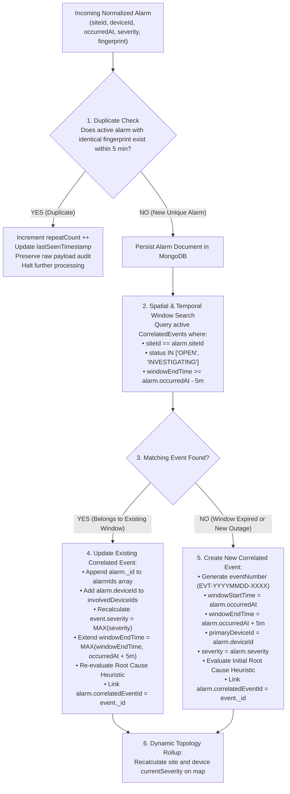
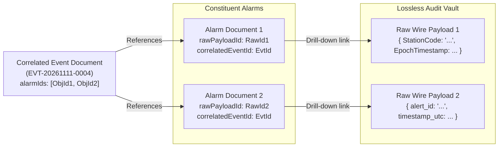
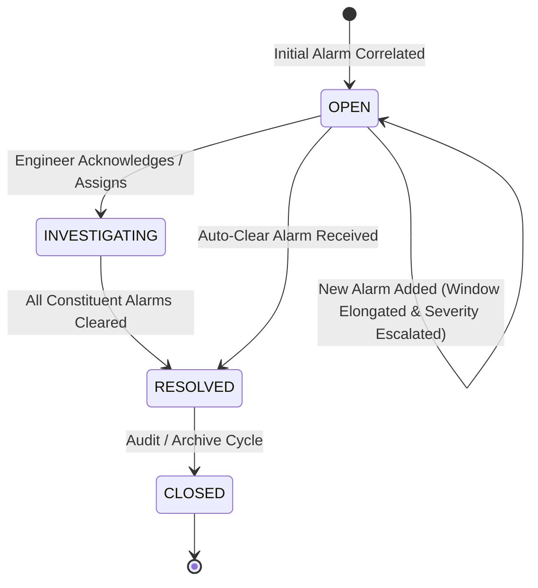

# App360 AIOps Alarm Correlation Engine Specification

> **Document Version:** 1.0.0  
> **Module:** Correlation Engine (`server/src/modules/correlation`)  
> **Concept:** AIOps Temporal & Topological Heuristic Event Aggregation  

---

## 1. Executive Summary & Correlation Philosophy

In high-density telecommunication and distributed IP networks, a single primary failure (e.g., an optical fiber severance, power grid failure, or core router restart) instantaneously triggers hundreds of downstream, secondary alarms across switches, wireless base stations, and edge devices. This phenomenon is known as an **Alarm Storm**.

Without intelligent correlation, Network Operations Center (NOC) engineers are overwhelmed by redundant alerts, leading to delayed **Mean Time to Resolution (MTTR)** and misdirected field dispatch.

**App360** implements a **rule-based, AIOps-aligned correlation engine** designed to:
1. **Deduplicate redundant alerts** generated repeatedly by flapping interfaces or persistent telemetry polls.
2. **Cluster spatially related alarms** occurring at the same geographical site or originating from the same physical device.
3. **Group temporally proximate alarms** arriving within a sliding 5-minute ($\Delta t \le 300\text{s}$) failure window.
4. **Elongate active event boundaries dynamically** when overlapping cascading failures arrive before window expiration.
5. **Synthesize a unified Correlated Incident** with an automated root cause hypothesis, escalating the incident's overall severity to the highest observed severity among its constituent alarms.
6. **Preserve full traceability** enabling instant one-click drill-down from the correlated incident to the exact raw wire payloads.

---

## 2. Correlation Dimensions & Core Rules



---

## 3. Explicit Rule Specifications

### 3.1. Same Site Matching
- **Definition:** Telecommunications equipment housed within the same physical shelter, cell tower, or data center share environmental and power infrastructure.
- **Rule:** If an incoming normalized alarm shares the exact `siteId` (case-insensitive string) with an active correlated incident whose sliding temporal window has not lapsed, the alarm is grouped into that existing incident.

### 3.2. Same Device Matching
- **Definition:** Multiple distinct alarms frequently emanate from a single device (e.g., `HIGH_CPU`, `TEMPERATURE_WARNING`, `FAN_FAILURE`, and `BGP_PEER_DOWN` all firing on `RTR-MUM-CORE-01`).
- **Rule:** When an alarm arrives for a device that already has active alarms inside the site event, the device is designated as a high-probability **Primary Fault Device**, and the new alarm is appended as a symptom of that device's failure state.

### 3.3. Five-Minute Sliding Time Window ($\Delta t = 300\text{ seconds}$)
- **Mathematical Definition:**  
  Let the initial alarm arrive at timestamp $T_1$.  
  The correlated incident establishes:
  $$\text{windowStartTime} = T_1$$
  $$\text{windowEndTime} = T_1 + 300\text{ seconds}$$
- **Sliding Behavior:**  
  Unlike rigid fixed-time bins (e.g., rigid hourly or 5-minute blocks that arbitrarily cut cascading failures in half), App360 implements a **sliding window**.  
  If a second alarm arrives at $T_2$ such that:
  $$T_1 \le T_2 \le \text{windowEndTime}$$
  The alarm falls squarely inside the window.

### 3.4. Overlapping Time-Window Behavior (Window Elongation)
- **Problem:** Cascading failures propagate across networks over multiple minutes. A power failure at $T = 0$ may cause an access switch to drop battery at $T = 4\text{m}$, which causes edge radio links to die at $T = 7\text{m}$. A rigid 5-minute window would split this single incident into two disconnected events.
- **App360 Solution:**  
  When an alarm arrives at $T_{\text{new}}$ within the active window ($T_{\text{new}} \le \text{windowEndTime}$), the window end boundary is dynamically elongated:
  $$\text{windowEndTime} = \max(\text{windowEndTime}, T_{\text{new}} + 300\text{ seconds})$$
- **Guardrail (Max Duration Cap):** To prevent an indefinite rolling window during persistent flapping, a hard cap of **2 hours** ($\text{maxWindowDuration} = 7200\text{s}$) is enforced. If $T_{\text{new}} - \text{windowStartTime} > 7200\text{s}$, the existing event is closed, and a new incident is created.

### 3.5. Duplicate Alarm Handling & Deduplication
- **Definition:** Telemetry polling or chatty protocols often re-send identical alerts every 30 seconds while an issue persists.
- **Deduplication Fingerprint Formula:**
  $$\text{Fingerprint} = \text{SHA256}(\text{sourceId} \parallel \text{siteId} \parallel \text{deviceId} \parallel \text{alarmType} \parallel \text{severity})$$
- **Deduplication Logic:**  
  Before inserting a new alarm document, the engine queries for an existing alarm where:
  - `fingerprint == currentFingerprint`
  - `status == 'ACTIVE'`
  - $\text{now} - \text{occurredAt} \le 300\text{ seconds}$
- **Action on Match:**  
  - The incoming raw payload is still immutably appended to `raw_alarm_payloads` for audit compliance.
  - The existing alarm document increments its counter: `repeatCount = repeatCount + 1`.
  - The alarm's `updatedAt` is refreshed to current time.
  - No new alarm document is created, preventing database bloat and downstream event inflation.

### 3.6. Existing Event Updates & Severity Escalation
- **Severity Hierarchy:**
  $$\text{CRITICAL} (4) > \text{MAJOR} (3) > \text{MINOR} (2) > \text{WARNING} (1) > \text{CLEAR} (0)$$
- **Dynamic Escalation:**  
  When a new alarm is appended to an existing event, the event's severity is updated to:
  $$\text{event.severity} = \max(\text{event.severity}, \text{alarm.severity})$$
  *Example:* If an existing event has severity `WARNING` due to high ambient temperature, and an incoming alarm reports `CRITICAL` power failure, the entire correlated incident escalates to `CRITICAL` immediately.
- **Involved Devices Array:**  
  The engine appends `alarm.deviceId` to `involvedDeviceIds` using a set union operation (`$addToSet` in MongoDB), ensuring an accurate inventory of affected hardware without duplicates.

### 3.7. Raw Alarm Drill-Down Architecture
Every correlated incident maintains explicit two-way referential integrity with its constituent alarms and raw payloads:



In the Next.js UI:
1. Engineer views the **Correlated Events Dashboard**.
2. Clicks on an incident to expand the **Constituent Alarms Drawer**.
3. Clicks on any individual alarm row to open the **Raw Payload Modal**, displaying the original formatted JSON wire message received from the external source.

---

## 4. Automated Root Cause Heuristic Engine

The correlation engine applies deterministic causal heuristics based on network topology roles:

```typescript
function determineRootCause(
  siteId: string, 
  alarms: IAlarm[], 
  involvedDevices: IDevice[]
): { primaryDeviceId: string; heuristicReason: string } {
  // Rule 1: Power & Facility Failure takes absolute precedence
  const powerAlarm = alarms.find(a => 
    a.alarmType.includes('POWER') || 
    a.alarmType.includes('MAINS_FAIL') || 
    a.alarmType.includes('GENERATOR')
  );
  if (powerAlarm) {
    return {
      primaryDeviceId: powerAlarm.deviceId,
      heuristicReason: `Site-wide AC Mains/Power Failure at ${siteId}. All downstream device unreachability is collateral.`
    };
  }

  // Rule 2: Upstream Core Router Outage
  const coreRouterAlarm = alarms.find(a => {
    const dev = involvedDevices.find(d => d.deviceId === a.deviceId);
    return dev?.type === 'ROUTER' && (a.severity === 'CRITICAL' || a.alarmType.includes('LINK_DOWN') || a.alarmType.includes('BGP'));
  });
  if (coreRouterAlarm) {
    return {
      primaryDeviceId: coreRouterAlarm.deviceId,
      heuristicReason: `Upstream Core Router (${coreRouterAlarm.deviceId}) link termination. Downstream switches and radio sectors isolated.`
    };
  }

  // Rule 3: Environmental / HVAC Overheat
  const tempAlarms = alarms.filter(a => a.alarmType.includes('TEMP') || a.alarmType.includes('THERMAL'));
  if (tempAlarms.length >= 2) {
    return {
      primaryDeviceId: tempAlarms[0].deviceId,
      heuristicReason: `Thermal Runaway / HVAC Failure at ${siteId} affecting multiple chassis.`
    };
  }

  // Fallback Rule: Earliest Critical Alarm
  const earliestCritical = [...alarms].sort((a, b) => a.occurredAt.getTime() - b.occurredAt.getTime())[0];
  return {
    primaryDeviceId: earliestCritical.deviceId,
    heuristicReason: `Topological Cascade initiated by ${earliestCritical.alarmType} on ${earliestCritical.deviceId}.`
  };
}
```

---

## 5. Correlated Event Lifecycle State Machine



- **OPEN**: Active incident currently receiving or awaiting cascading alarms.
- **INVESTIGATING**: Operator has taken ownership via the dashboard.
- **RESOLVED**: Alarms have received `CLEAR` notifications or normal status restored.
- **CLOSED**: Fully reconciled incident archived for historical reporting.
