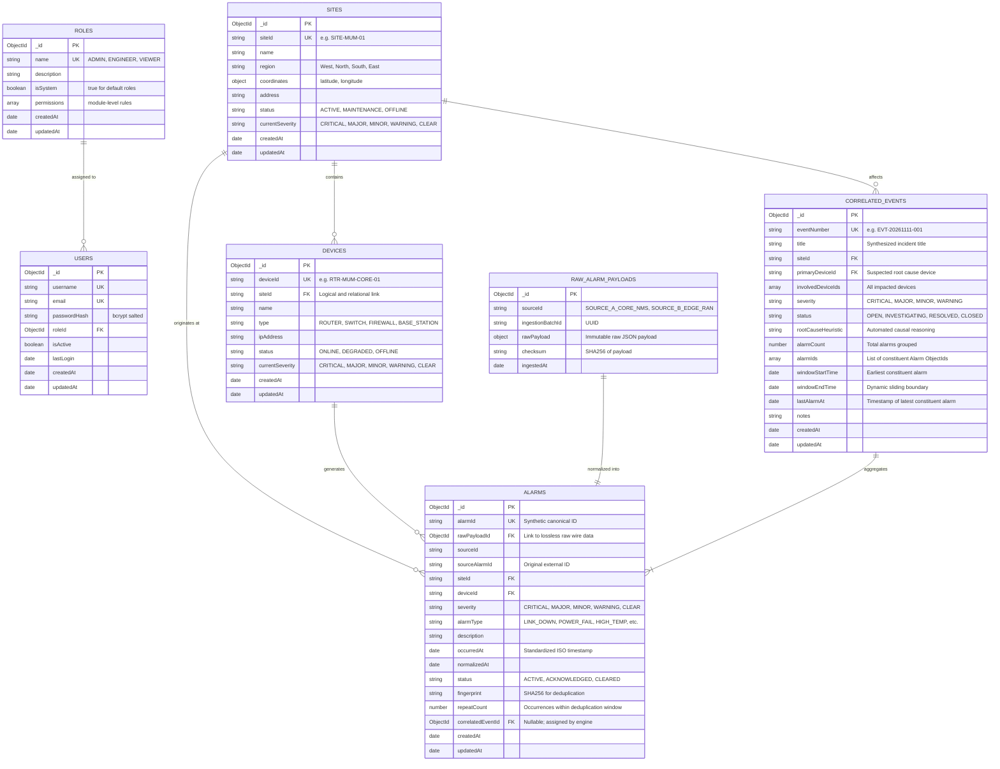

# App360 Database Design & Schema Specification

> **Document Version:** 1.0.0  
> **Database Engine:** MongoDB 6.0+ with Mongoose ODM  
> **Target Models:** Users, Roles, Sites, Devices, RawAlarmPayloads, Alarms, CorrelatedEvents  

---

## 1. Schema Philosophy & Architectural Principles

The App360 database design uses a **hybrid relational-document pattern**:
1. **Referential Integrity for Topology and Security**: Core entities (Users, Roles, Sites, Devices) maintain explicit object references (`ObjectId`) with compound indexes to enforce relational integrity and rapid lookup.
2. **Audit Preservation (Lossless Telemetry)**: Raw incoming payloads are stored immutably in `raw_alarm_payloads` before schema transformation, ensuring zero data loss and forensic compliance.
3. **High-Performance Correlation Indexing**: Alarms and Correlated Events feature compound indexes covering spatial dimensions (`siteId`, `deviceId`), temporal dimensions (`occurredAt`, `windowStartTime`, `windowEndTime`), and status flags.
4. **Dynamic RBAC Storage**: Module permissions are embedded within the `roles` collection as structured subdocuments, allowing runtime modification without schema migrations or hardcoded code deploys.

---

## 2. Entity-Relationship Diagram (ERD)



---

## 3. Detailed Collection Schemas

### 3.1. `roles` Collection
Stores system roles and dynamically configurable module permissions.

```typescript
import { Schema, Document } from 'mongoose';

export enum SystemModule {
  ALARM = 'ALARM',
  MAP = 'MAP',
  API = 'API',
  USER_MANAGEMENT = 'USER_MANAGEMENT'
}

export enum ActionPermission {
  READ = 'READ',
  CREATE = 'CREATE',
  UPDATE = 'UPDATE',
  DELETE = 'DELETE',
  EXECUTE = 'EXECUTE'
}

export interface IModulePermission {
  module: SystemModule;
  actions: ActionPermission[];
}

export interface IRole extends Document {
  name: string;
  description: string;
  isSystem: boolean;
  permissions: IModulePermission[];
  createdAt: Date;
  updatedAt: Date;
}

export const RoleSchema = new Schema<IRole>({
  name: { 
    type: String, 
    required: true, 
    unique: true, 
    uppercase: true, 
    trim: true 
  },
  description: { type: String, default: '' },
  isSystem: { type: Boolean, default: false },
  permissions: [{
    _id: false,
    module: { 
      type: String, 
      enum: Object.values(SystemModule), 
      required: true 
    },
    actions: [{ 
      type: String, 
      enum: Object.values(ActionPermission), 
      required: true 
    }]
  }]
}, { timestamps: true });

// Indexes
RoleSchema.index({ name: 1 }, { unique: true });
```

---

### 3.2. `users` Collection
Stores operator accounts and references their assigned role.

```typescript
export interface IUser extends Document {
  username: string;
  email: string;
  passwordHash: string;
  roleId: Schema.Types.ObjectId;
  isActive: boolean;
  lastLogin?: Date;
  createdAt: Date;
  updatedAt: Date;
}

export const UserSchema = new Schema<IUser>({
  username: { 
    type: String, 
    required: true, 
    unique: true, 
    trim: true, 
    minlength: 3, 
    maxlength: 50 
  },
  email: { 
    type: String, 
    required: true, 
    unique: true, 
    lowercase: true, 
    trim: true 
  },
  passwordHash: { 
    type: String, 
    required: true, 
    select: false // Never exposed in standard queries
  },
  roleId: { 
    type: Schema.Types.ObjectId, 
    ref: 'Role', 
    required: true 
  },
  isActive: { type: Boolean, default: true },
  lastLogin: { type: Date }
}, { timestamps: true });

// Indexes
UserSchema.index({ username: 1 }, { unique: true });
UserSchema.index({ email: 1 }, { unique: true });
UserSchema.index({ roleId: 1 });
```

---

### 3.3. `sites` Collection
Stores physical geographic telecommunications sites and calculated rollup status.

```typescript
export interface IGeoCoordinates {
  latitude: number;
  longitude: number;
}

export interface ISite extends Document {
  siteId: string;
  name: string;
  region: string;
  coordinates: IGeoCoordinates;
  address: string;
  status: 'ACTIVE' | 'MAINTENANCE' | 'OFFLINE';
  currentSeverity: 'CRITICAL' | 'MAJOR' | 'MINOR' | 'WARNING' | 'CLEAR';
  activeAlarmCount: number;
  createdAt: Date;
  updatedAt: Date;
}

export const SiteSchema = new Schema<ISite>({
  siteId: { 
    type: String, 
    required: true, 
    unique: true, 
    uppercase: true, 
    trim: true 
  },
  name: { type: String, required: true },
  region: { 
    type: String, 
    required: true, 
    enum: ['West', 'North', 'South', 'East', 'Central'] 
  },
  coordinates: {
    latitude: { type: Number, required: true },
    longitude: { type: Number, required: true }
  },
  address: { type: String, default: '' },
  status: { 
    type: String, 
    enum: ['ACTIVE', 'MAINTENANCE', 'OFFLINE'], 
    default: 'ACTIVE' 
  },
  currentSeverity: { 
    type: String, 
    enum: ['CRITICAL', 'MAJOR', 'MINOR', 'WARNING', 'CLEAR'], 
    default: 'CLEAR' 
  },
  activeAlarmCount: { type: Number, default: 0 }
}, { timestamps: true });

// Indexes
SiteSchema.index({ siteId: 1 }, { unique: true });
SiteSchema.index({ region: 1, currentSeverity: 1 });
SiteSchema.index({ 'coordinates.latitude': 1, 'coordinates.longitude': 1 });
```

---

### 3.4. `devices` (Nodes) Collection
Stores network equipment items belonging to a site.

```typescript
export interface IDevice extends Document {
  deviceId: string;
  siteId: string;
  name: string;
  type: 'ROUTER' | 'SWITCH' | 'FIREWALL' | 'BASE_STATION' | 'POWER_SUPPLY';
  ipAddress: string;
  status: 'ONLINE' | 'DEGRADED' | 'OFFLINE';
  currentSeverity: 'CRITICAL' | 'MAJOR' | 'MINOR' | 'WARNING' | 'CLEAR';
  createdAt: Date;
  updatedAt: Date;
}

export const DeviceSchema = new Schema<IDevice>({
  deviceId: { 
    type: String, 
    required: true, 
    unique: true, 
    uppercase: true, 
    trim: true 
  },
  siteId: { 
    type: String, 
    required: true, 
    ref: 'Site', 
    uppercase: true, 
    trim: true 
  },
  name: { type: String, required: true },
  type: { 
    type: String, 
    enum: ['ROUTER', 'SWITCH', 'FIREWALL', 'BASE_STATION', 'POWER_SUPPLY'], 
    required: true 
  },
  ipAddress: { type: String, required: true },
  status: { 
    type: String, 
    enum: ['ONLINE', 'DEGRADED', 'OFFLINE'], 
    default: 'ONLINE' 
  },
  currentSeverity: { 
    type: String, 
    enum: ['CRITICAL', 'MAJOR', 'MINOR', 'WARNING', 'CLEAR'], 
    default: 'CLEAR' 
  }
}, { timestamps: true });

// Indexes
DeviceSchema.index({ deviceId: 1 }, { unique: true });
DeviceSchema.index({ siteId: 1, currentSeverity: 1 });
DeviceSchema.index({ status: 1 });
```

---

### 3.5. `raw_alarm_payloads` Collection
Stores the untouched, original wire JSON data from external mock APIs.

```typescript
export interface IRawAlarmPayload extends Document {
  sourceId: string;
  ingestionBatchId: string;
  rawPayload: Record<string, any>;
  checksum: string;
  ingestedAt: Date;
}

export const RawAlarmPayloadSchema = new Schema<IRawAlarmPayload>({
  sourceId: { type: String, required: true },
  ingestionBatchId: { type: String, required: true, index: true },
  rawPayload: { type: Schema.Types.Mixed, required: true },
  checksum: { type: String, required: true },
  ingestedAt: { type: Date, default: Date.now, index: true }
});

// Indexes
RawAlarmPayloadSchema.index({ checksum: 1 });
RawAlarmPayloadSchema.index({ ingestedAt: -1 });
```

---

### 3.6. `alarms` Collection
Stores normalized alarms with link back to raw payload and forward link to correlated event.

```typescript
export type AlarmSeverity = 'CRITICAL' | 'MAJOR' | 'MINOR' | 'WARNING' | 'INFO';
export type AlarmStatus = 'ACTIVE' | 'ACKNOWLEDGED' | 'CLEARED';

export interface IAlarm extends Document {
  sourceId: string;
  externalAlarmId: string;
  siteId: string;
  deviceId: string;
  severity: AlarmSeverity;
  alarmType: string;
  message: string;
  timestamp: Date;
  normalizedAt: Date;
  status: AlarmStatus;
  rawPayload: Record<string, any>;
  rawPayloadId?: Schema.Types.ObjectId;
  ingestedAt: Date;
  repeatCount: number;
  correlatedEventId?: Schema.Types.ObjectId;
  createdAt: Date;
  updatedAt: Date;
}
```

Compound Indexes:
- `{ sourceId: 1, externalAlarmId: 1 }` (**Unique** for deduplication)
- `{ siteId: 1, deviceId: 1, timestamp: -1 }`
- `{ status: 1, severity: 1 }`
- `{ ingestedAt: -1 }`

---

### 3.7. `ingestion_logs` Collection
Stores structured audit records for scheduled and manual ingestion cycles.

```typescript
export interface IIngestionLog extends Document {
  batchId: string;
  triggeredBy: 'SCHEDULER' | 'MANUAL' | 'SYSTEM';
  triggeredByEmail?: string;
  status: 'SUCCESS' | 'PARTIAL' | 'FAILED';
  sources: {
    sourceId: string;
    status: 'SUCCESS' | 'FAILED';
    fetchedCount: number;
    normalizedCount: number;
    duplicateCount: number;
    error?: string;
  }[];
  totalFetched: number;
  totalNormalized: number;
  totalDuplicates: number;
  totalFailed: number;
  durationMs: number;
  startedAt: Date;
  completedAt: Date;
}
```

Indexes:
- `{ batchId: 1 }` (**Unique**)
- `{ startedAt: -1 }`
- `{ status: 1 }`

---

### 3.7. `correlated_events` Collection
Stores correlated AIOps incidents aggregating multiple raw alarms.

```typescript
export type EventSeverity = 'CRITICAL' | 'MAJOR' | 'MINOR' | 'WARNING';
export type EventStatus = 'OPEN' | 'INVESTIGATING' | 'RESOLVED' | 'CLOSED';

export interface ICorrelatedEvent extends Document {
  eventNumber: string;
  title: string;
  siteId: string;
  primaryDeviceId: string;
  involvedDeviceIds: string[];
  severity: EventSeverity;
  status: EventStatus;
  rootCauseHeuristic: string;
  alarmCount: number;
  alarmIds: Schema.Types.ObjectId[];
  windowStartTime: Date;
  windowEndTime: Date;
  lastAlarmAt: Date;
  notes?: string;
  createdAt: Date;
  updatedAt: Date;
}

export const CorrelatedEventSchema = new Schema<ICorrelatedEvent>({
  eventNumber: { type: String, required: true, unique: true, index: true },
  title: { type: String, required: true },
  siteId: { type: String, required: true, uppercase: true, index: true },
  primaryDeviceId: { type: String, required: true, uppercase: true },
  involvedDeviceIds: [{ type: String, uppercase: true }],
  severity: { 
    type: String, 
    enum: ['CRITICAL', 'MAJOR', 'MINOR', 'WARNING'], 
    required: true,
    index: true 
  },
  status: { 
    type: String, 
    enum: ['OPEN', 'INVESTIGATING', 'RESOLVED', 'CLOSED'], 
    default: 'OPEN',
    index: true 
  },
  rootCauseHeuristic: { type: String, required: true },
  alarmCount: { type: Number, default: 1 },
  alarmIds: [{ type: Schema.Types.ObjectId, ref: 'Alarm' }],
  windowStartTime: { type: Date, required: true, index: true },
  windowEndTime: { type: Date, required: true, index: true },
  lastAlarmAt: { type: Date, required: true },
  notes: { type: String, default: '' }
}, { timestamps: true });

// Compound Indexes for temporal window matching
CorrelatedEventSchema.index({ siteId: 1, status: 1, windowEndTime: -1 });
CorrelatedEventSchema.index({ status: 1, severity: 1 });
CorrelatedEventSchema.index({ windowStartTime: -1 });
```

---

## 4. Indexing & Query Optimization Summary

| Collection | Index Fields | Purpose |
| :--- | :--- | :--- |
| `users` | `{ email: 1 }`, `{ username: 1 }` (Unique) | O(1) user credential lookup during login |
| `roles` | `{ name: 1 }` (Unique) | Fast role and permission retrieval |
| `sites` | `{ siteId: 1 }` (Unique), `{ region: 1, currentSeverity: 1 }` | Fast map viewport and region/severity filtering |
| `devices` | `{ deviceId: 1 }` (Unique), `{ siteId: 1, currentSeverity: 1 }` | Fast site drill-down and node selection |
| `raw_alarm_payloads` | `{ checksum: 1 }`, `{ ingestedAt: -1 }` | Duplicate payload suppression and audit range scans |
| `alarms` | `{ siteId: 1, deviceId: 1, occurredAt: -1 }` | Temporal matching for correlation engine |
| `alarms` | `{ fingerprint: 1, status: 1 }` | O(1) deduplication of incoming active alarms |
| `correlated_events` | `{ siteId: 1, status: 1, windowEndTime: -1 }` | Instant lookup of active sliding windows per site |
| `correlated_events` | `{ status: 1, severity: 1 }` | High-level dashboard KPI queries |

