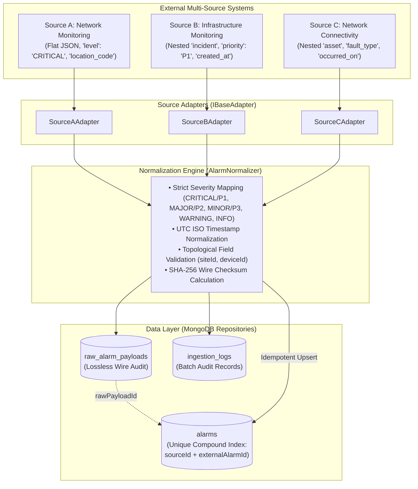

# App360 Multi-Source Telemetry Ingestion & Normalization Pipeline

> **Document Version:** 1.0.0  
> **Status:** Production Implementation (Phase 3 Complete)  
> **Target Audience:** Backend Engineers, System Architects, Integration Engineers, DevOps  

---

## 1. Pipeline Overview & Architecture

The App360 Multi-Source Ingestion Pipeline is designed to ingest telemetry from multiple heterogeneous vendor systems, transform vendor-specific data structures into a unified canonical schema, preserve original raw payloads for lossless forensic audit, prevent duplicate alarm explosion, and schedule background polling.



---

## 2. Multi-Source Adapter Architecture

Each data source is isolated in an independent adapter under `backend/src/adapters/`:

### 2.1. Source A – Network Monitoring (`SourceAAdapter`)
- **Format:**
  ```json
  {
    "event_id": "NET-1001",
    "node": "RTR001",
    "location_code": "CHN001",
    "alarm": "HIGH_CPU",
    "level": "CRITICAL",
    "description": "CPU usage exceeded 90 percent",
    "event_time": "2026-11-11T10:00:00Z"
  }
  ```
- **Mapping:**
  - `sourceId` $\rightarrow$ `'SOURCE_A'`
  - `externalAlarmId` $\rightarrow$ `event_id`
  - `deviceId` $\rightarrow$ `node`
  - `siteId` $\rightarrow$ `location_code`
  - `alarmType` $\rightarrow$ `alarm`
  - `severity` $\rightarrow$ `level`
  - `message` $\rightarrow$ `description`
  - `timestamp` $\rightarrow$ `event_time`

### 2.2. Source B – Infrastructure Monitoring (`SourceBAdapter`)
- **Format:**
  ```json
  {
    "incident": {
      "id": "INF-2001",
      "device": "RTR001",
      "site": "CHN001",
      "category": "CPU_THRESHOLD",
      "priority": "P1",
      "details": "High processor utilization",
      "created_at": "2026-11-11T10:02:00Z"
    }
  }
  ```
- **Mapping:**
  - `sourceId` $\rightarrow$ `'SOURCE_B'`
  - `externalAlarmId` $\rightarrow$ `incident.id`
  - `deviceId` $\rightarrow$ `incident.device`
  - `siteId` $\rightarrow$ `incident.site`
  - `alarmType` $\rightarrow$ `incident.category`
  - `severity` $\rightarrow$ `incident.priority` (P1 mapped to CRITICAL)
  - `message` $\rightarrow$ `incident.details`
  - `timestamp` $\rightarrow$ `incident.created_at`

### 2.3. Source C – Network Connectivity (`SourceCAdapter`)
- **Format:**
  ```json
  {
    "notification_id": "CON-3001",
    "asset": {
      "identifier": "RTR001",
      "site_code": "CHN001"
    },
    "fault_type": "PACKET_LOSS",
    "severity": "MAJOR",
    "message": "Network packet loss detected",
    "occurred_on": "2026-11-11T10:04:00Z"
  }
  ```
- **Mapping:**
  - `sourceId` $\rightarrow$ `'SOURCE_C'`
  - `externalAlarmId` $\rightarrow$ `notification_id`
  - `deviceId` $\rightarrow$ `asset.identifier`
  - `siteId` $\rightarrow$ `asset.site_code`
  - `alarmType` $\rightarrow$ `fault_type`
  - `severity` $\rightarrow$ `severity`
  - `message` $\rightarrow$ `message`
  - `timestamp` $\rightarrow$ `occurred_on`

---

## 3. Normalization Logic & Canonical Schema

All heterogeneous items are validated and normalized by `AlarmNormalizer.js` into the internal canonical schema:

```json
{
  "sourceId": "SOURCE_A",
  "externalAlarmId": "NET-1001",
  "siteId": "CHN001",
  "deviceId": "RTR001",
  "alarmType": "HIGH_CPU",
  "severity": "CRITICAL",
  "message": "CPU usage exceeded 90 percent",
  "timestamp": "2026-11-11T10:00:00.000Z",
  "status": "ACTIVE",
  "rawPayload": { ... }
}
```

### Severity Standard Matrix
| Vendor Input Codes | Standardized Severity | Behavior on Unknown |
| :--- | :---: | :--- |
| `CRITICAL`, `P1`, `FATAL`, `100` | **`CRITICAL`** | Rejection with `Error: Unknown severity value` |
| `MAJOR`, `P2`, `HIGH`, `200` | **`MAJOR`** | Rejection with `Error: Unknown severity value` |
| `MINOR`, `P3`, `MED`, `MEDIUM`, `300` | **`MINOR`** | Rejection with `Error: Unknown severity value` |
| `WARNING`, `WARN`, `P4`, `LOW`, `400` | **`WARNING`** | Rejection with `Error: Unknown severity value` |
| `INFO`, `INFORMATIONAL`, `P5`, `500` | **`INFO`** | Rejection with `Error: Unknown severity value` |

> [!IMPORTANT]
> The engine **never** silently defaults invalid or unmapped severities to normal or info. Any unmapped code causes an explicit validation failure recorded in the ingestion batch audit log.

---

## 4. Duplicate Prevention & Raw Payload Preservation

### Deduplication Strategy:
1. **Unique Compound Index**: MongoDB collection `alarms` enforces `{ sourceId: 1, externalAlarmId: 1 }` with `{ unique: true }`.
2. **Idempotent Upsert Operation**:
   ```javascript
   const existing = await Alarm.findOne({ sourceId, externalAlarmId });
   if (existing) {
     existing.repeatCount += 1;
     existing.status = 'ACTIVE';
     await existing.save();
   } else {
     await Alarm.create({ ...canonical, repeatCount: 1 });
   }
   ```
3. **Lossless Raw Wire Preservation**:
   - Every raw wire JSON payload received from external APIs is saved into `raw_alarm_payloads` with a SHA-256 payload checksum and batch ID.
   - During duplicate updates, the original raw payload is never overwritten or destroyed, enabling forensic drill-down via `GET /api/alarms/:id/raw`.

---

## 5. Fault Isolation & Scheduler Behavior

### Independent Source Failure Isolation:
If `Source B` experiences a network timeout or HTTP 500 error:
- `SourceAAdapter` and `SourceCAdapter` continue to fetch and process normally.
- The batch is recorded with status `PARTIAL` in `ingestion_logs`.
- The error message is attached specifically to the `Source B` log entry.

### Cron Scheduling (`backend/src/jobs/ingestion.job.js`):
- Powered by `node-cron`.
- Configurable expression: `INGESTION_CRON` (default: `*/1 * * * *`, every 60 seconds).
- Enable/disable toggle: `INGESTION_ENABLED=true/false`.
- **Concurrency Mutex Lock**: An in-memory atomic lock (`isIngestionRunning`) prevents duplicate overlapping runs if a previous polling cycle takes longer than 60 seconds.
- Single-instance note: For multi-instance clustered deployments, Redis/Redlock or MongoDB collection lease locks should be configured.

