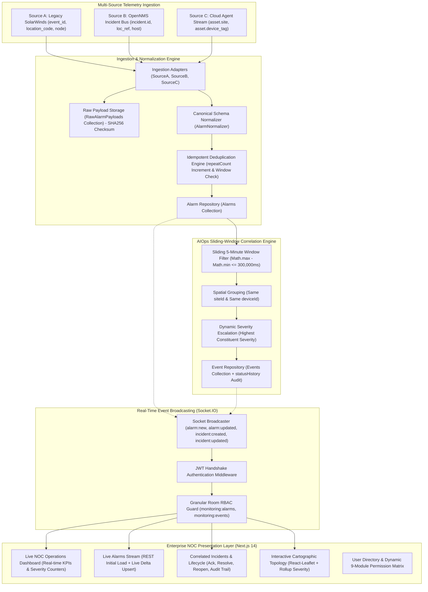
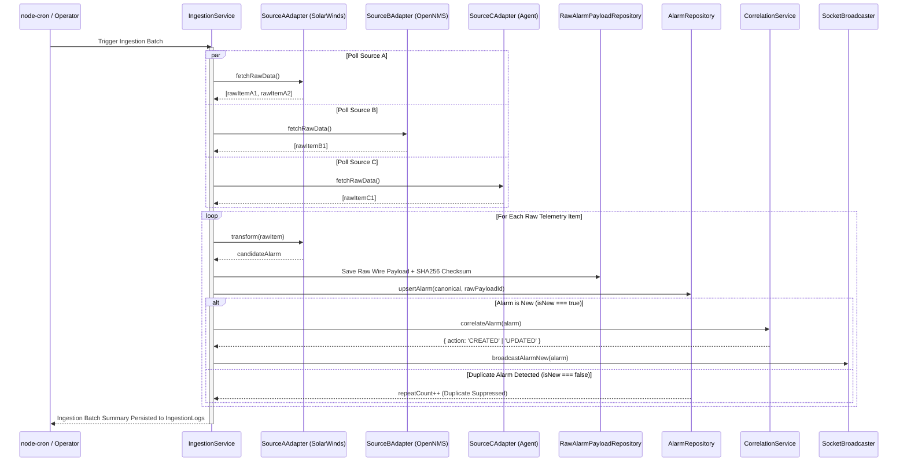

# App360 – Master Architecture, Technical Specification & Final Delivery Report

> **System Classification:** Enterprise Carrier-Grade Network Operations Center (NOC) Telemetry Ingestion, AIOps Alarm Correlation & Dynamic RBAC Platform  
> **Status:** Production-Ready (Phases 1 through 8 Completed & Verified)  
> **Test Coverage:** 185 / 185 Automated Test Assertions Passing (100%)  
> **Release Date:** November 2026

---

## Complete End-to-End Telemetry Pipeline



---

## SECTION 1: Project Overview

App360 is a carrier-grade, enterprise Network Operations Center (NOC) management platform built to ingest, normalize, correlate, and visualize massive telemetry and alarm streams from heterogeneous network monitoring systems.

### Core Value Drivers
1. **AIOps Noise Reduction:** Modern telecom and cloud infrastructures suffer from severe "alarm storms" where a single hardware failure (such as a core optical link or power supply failure) generates hundreds of downstream alarms. App360's correlation engine automatically collapses redundant alarms into unified actionable incidents using temporal and spatial rules.
2. **Multi-Source Vendor Neutrality:** Out-of-the-box adapters ingest telemetry from legacy SNMP trap managers (SolarWinds), modern open-source collectors (OpenNMS), and proprietary cloud agents, normalizing them into an open canonical schema.
3. **Lossless Wire Auditability:** The raw JSON payloads received from external systems are cryptographically hashed (SHA-256) and preserved in a dedicated audit collection, enabling operators to inspect the exact wire payload for forensic investigations.
4. **Dynamic Database-Driven RBAC:** Complete multi-tenant authorization covering 9 functional modules with granular CRUD permissions. Permission updates take effect instantly in MongoDB without restarting backend servers.
5. **Carrier-Grade Real-Time Broadcasting:** Full-duplex Socket.IO WebSocket communication layers stream newly ingested alarms, correlation events, and operator lifecycle transitions to all connected NOC dashboards with zero polling delay.

---

## SECTION 2: System Architecture

App360 enforces a strict three-tier layered architecture with unidirectional dependencies:

```
┌─────────────────────────────────────────────────────────────┐
│               PRESENTATION LAYER (Next.js 14)               │
│  - App Router Architecture       - Tailwind CSS Modern UI   │
│  - React-Leaflet GIS Topology    - Authenticated Socket.IO  │
│  - SWR/REST Initial Data Fetch   - Dynamic Permissions RBAC │
└──────────────────────────────▲──────────────────────────────┘
                               │ HTTP REST & WebSocket (Strict)
┌──────────────────────────────▼──────────────────────────────┐
│             BUSINESS LOGIC LAYER (Express.js)               │
│  - Controllers & Routes          - Socket.IO Server Engine  │
│  - JWT & RBAC Middleware         - Socket Room RBAC Guard   │
│  - Multi-Source Ingestion Service- Ingestion Adapters (A,B,C)│
│  - Canonical Normalizer          - Correlation Engine       │
│  - Audit Logging Service         - Background Cron Job      │
└──────────────────────────────▲──────────────────────────────┘
                               │ Repositories Only
┌──────────────────────────────▼──────────────────────────────┐
│                    DATA LAYER (MongoDB)                     │
│  - BaseRepository & Sub-Classes  - Mongoose Schemas         │
│  - Users & Roles Collections     - Alarms & Raw Payloads    │
│  - Correlated Events Collection  - Network Sites & Devices  │
│  - Ingestion & Audit Logs        - Compound Database Indexes│
└─────────────────────────────────────────────────────────────┘
```

### Architectural Guardrails
- **Presentation Layer Separation:** Next.js components never access the database directly; all interactions traverse authenticated REST APIs or authenticated Socket.IO channels.
- **Business Logic Decoupling:** Controllers only handle HTTP request parsing, status codes, and response envelopes. All domain logic, aggregation formulas, correlation algorithms, and WebSocket broadcasts reside exclusively within domain services.
- **Repository Abstraction:** All database queries pass through dedicated Mongoose Repository classes (`UserRepository`, `RoleRepository`, `AlarmRepository`, `EventRepository`, `RawAlarmPayloadRepository`).

---

## SECTION 3: Folder Structure

```
E:\App360\
├── backend\
│   ├── src\
│   │   ├── adapters\              # Multi-source vendor ingestion adapters
│   │   │   ├── SourceAAdapter.js  # SolarWinds legacy mapping
│   │   │   ├── SourceBAdapter.js  # OpenNMS incident mapping
│   │   │   └── SourceCAdapter.js  # Custom agent asset mapping
│   │   ├── config\                # Environment, CORS, DB configurations
│   │   ├── constants\             # Socket events, room names, permission enums
│   │   ├── controllers\           # HTTP route controllers
│   │   ├── jobs\                  # Background node-cron ingestion scheduler
│   │   ├── middleware\            # JWT auth, RBAC authorization, rate limiter, errors
│   │   ├── models\                # Mongoose domain models
│   │   ├── repositories\          # Database data-access layer classes
│   │   ├── routes\                # Express route definitions
│   │   ├── services\              # Business logic: correlation, normalizer, ingestion
│   │   ├── utils\                 # Seeding scripts, crypto helpers, responses
│   │   ├── websocket\             # Socket.IO server, roomManager, broadcaster
│   │   ├── app.js                 # Express application initialization
│   │   └── server.js              # HTTP & Socket.IO server entrypoint
│   ├── tests\                     # Automated integration test suites
│   │   ├── phase2.test.js         # Auth & RBAC
│   │   ├── phase3.test.js         # Multi-source ingestion & normalization
│   │   ├── phase4.test.js         # Alarm correlation engine
│   │   ├── phase5.test.js         # Network topology & GIS
│   │   ├── phase6.test.js         # Dynamic RBAC administration
│   │   ├── phase7_1.test.js       # Real-time Socket.IO infrastructure
│   │   ├── phase7_2.test.js       # Live alarm & incident broadcasting
│   │   └── master_suite.test.js   # Master E2E Scenarios A through F (69 assertions)
│   ├── .env.example
│   └── package.json
├── frontend\
│   ├── src\
│   │   ├── app\                   # Next.js 14 App Router routes
│   │   │   ├── alarms\page.tsx    # Live alarms monitoring table
│   │   │   ├── api-sources\       # Telemetry ingestion control & raw logs
│   │   │   ├── dashboard\         # NOC Executive Overview & Metrics
│   │   │   │   ├── audit-logs\    # Compliance & audit trail
│   │   │   │   ├── permissions\   # Dynamic 9-Module Permission Matrix & Operator Switcher
│   │   │   │   ├── roles\         # Dynamic Role creation & editing
│   │   │   │   └── users\         # Operator User Directory
│   │   │   ├── events\page.tsx    # Correlated Incidents, Lifecycle & History
│   │   │   ├── login\page.tsx     # Operator authentication portal
│   │   │   ├── map\page.tsx       # Interactive Leaflet GIS Network Map
│   │   │   └── settings\page.tsx  # System status & operator profile
│   │   ├── components\            # Reusable UI components (Navbar, Modals, Badges)
│   │   ├── constants\             # Client-side Socket.IO constants
│   │   ├── context\               # AuthContext & SocketContext
│   │   ├── services\              # Axios API service clients & socketService
│   │   └── types\                 # TypeScript contracts (Alarm, Event, RBAC, User)
│   ├── .env.example
│   ├── next.config.mjs
│   ├── tailwind.config.ts
│   └── package.json
├── docs\                          # Architectural and operational documentation
├── catalyst.json                  # Zoho Catalyst serverless deployment packaging
└── README.md                      # Project master readme
```

---

## SECTION 4: Database Schema Documentation

App360 relies on MongoDB with Mongoose schemas configured with indexes for sub-millisecond query performance:

### 1. `users` Collection
- `name` (String, required, indexed)
- `email` (String, required, unique, lowercase, indexed)
- `passwordHash` (String, required, `select: false` to prevent accidental leak)
- `roleId` (ObjectId, ref: 'Role', required, indexed)
- `isActive` (Boolean, default: true)
- `timestamps` (createdAt, updatedAt)

### 2. `roles` Collection
- `name` (String, required, unique, uppercase, indexed)
- `description` (String)
- `isSystemRole` (Boolean, default: false) — Protects `ADMIN`, `ENGINEER`, `VIEWER` from deletion
- `permissions` (Map of 9 modules: `dashboard`, `alarm`, `event`, `map`, `api`, `user`, `role`, `settings`, `audit`)
  - Each module contains boolean flags: `read`, `create`, `update`, `delete`

### 3. `alarms` Collection
- `sourceId` (String, enum: `['SOURCE_A', 'SOURCE_B', 'SOURCE_C']`, indexed)
- `externalAlarmId` (String, required, indexed)
- `siteId` (String, uppercase, required, indexed)
- `deviceId` (String, uppercase, required, indexed)
- `alarmType` (String, required, indexed)
- `severity` (String, enum: `['CRITICAL', 'MAJOR', 'MINOR', 'WARNING', 'INFO']`, indexed)
- `message` (String, required)
- `timestamp` (Date, required, indexed)
- `status` (String, enum: `['ACTIVE', 'CLEARED', 'ACKNOWLEDGED']`, default: `'ACTIVE'`, indexed)
- `rawPayload` (Object, preserved wire format)
- `rawPayloadId` (ObjectId, ref: `'RawAlarmPayload'`)
- `repeatCount` (Number, default: 1) — Incremented upon duplicate arrival
- `correlatedEventId` (ObjectId, ref: `'Event'`, default: null, indexed)
- **Compound Indexes:** `{ siteId: 1, deviceId: 1, timestamp: -1 }`, `{ sourceId: 1, externalAlarmId: 1 }` (unique constraint for idempotency)

### 4. `events` Collection (Correlated Incidents)
- `eventId` (String, required, unique, indexed, e.g., `EVT-1718000000000-A1B2C3`)
- `siteId` (String, uppercase, required, indexed)
- `deviceId` (String, uppercase, required, indexed)
- `alarmIds` (Array of ObjectId, ref: `'Alarm'`, indexed)
- `correlationRule` (String, default: `'SAME_SITE_DEVICE_5MIN'`)
- `severity` (String, enum: `['CRITICAL', 'MAJOR', 'MINOR', 'WARNING', 'INFO']`, indexed)
- `status` (String, enum: `['OPEN', 'ACKNOWLEDGED', 'RESOLVED']`, default: `'OPEN'`, indexed)
- `firstOccurredAt` (Date, required, indexed)
- `lastOccurredAt` (Date, required, indexed)
- `notes` (String, default: '')
- `statusHistory` (Array of lifecycle audit objects):
  - `status` (String, enum: `['OPEN', 'ACKNOWLEDGED', 'RESOLVED']`)
  - `changedBy` (ObjectId, ref: `'User'`, or populated Object `{ id, name, email }`)
  - `changedAt` (Date, default: Date.now)
  - `notes` (String)

### 5. `raw_alarm_payloads` Collection
- `sourceId` (String, required)
- `externalAlarmId` (String, required)
- `ingestionBatchId` (String, required, indexed)
- `rawPayload` (Mixed, unaltered wire payload)
- `checksum` (String, SHA-256 hash)
- `ingestedAt` (Date, default: Date.now)

---

## SECTION 5: API Endpoint Documentation

| Method | Endpoint | Description | Required RBAC Permission |
|---|---|---|---|
| `POST` | `/api/auth/login` | Authenticate user & return JWT token | Public |
| `GET` | `/api/auth/me` | Retrieve authenticated operator profile | Authenticated |
| `GET` | `/api/users` | List registered operators (pagination & search) | `user:read` |
| `POST` | `/api/users` | Create operator user | `user:create` |
| `GET` | `/api/users/:id` | Get operator details | `user:read` |
| `PUT` | `/api/users/:id` | Update operator details / role assignment | `user:update` |
| `PATCH` | `/api/users/:id/status` | Activate / deactivate user account | `user:update` |
| `GET` | `/api/roles` | List all dynamic and system roles | `role:read` |
| `POST` | `/api/roles` | Create new custom dynamic role | `role:create` |
| `PUT` | `/api/roles/:id` | Update role permissions matrix | `role:update` |
| `DELETE` | `/api/roles/:id` | Delete custom role (if 0 users assigned) | `role:delete` |
| `GET` | `/api/permissions` | Get 9-module permissions matrix & user roster | `role:read` |
| `GET` | `/api/ingestion/status` | Ingestion status & registered sources | `api:read` |
| `POST` | `/api/ingestion/trigger` | Manually execute multi-source ingestion cycle | `api:create` |
| `GET` | `/api/ingestion/logs` | Query ingestion batch history | `api:read` |
| `GET` | `/api/alarms` | Query alarms (filters: severity, status, site) | `alarm:read` |
| `GET` | `/api/alarms/:id/raw` | Retrieve preserved lossless wire JSON payload | `alarm:read` |
| `GET` | `/api/alarms/stats` | Alarm counts grouped by severity & status | `dashboard:read` |
| `GET` | `/api/events` | Query correlated incidents | `event:read` |
| `GET` | `/api/events/:id/alarms` | Drill-down: member alarms & statusHistory | `event:read` |
| `POST` | `/api/events/:id/acknowledge`| Transition incident status to ACKNOWLEDGED | `alarm:update` |
| `POST` | `/api/events/:id/resolve` | Resolve incident and auto-clear member alarms | `alarm:update` |
| `POST` | `/api/events/:id/reopen` | Reopen resolved incident and reactivate alarms| `alarm:update` |
| `GET` | `/api/correlation/stats` | Noise reduction rate & incident KPIs | `dashboard:read` |
| `GET` | `/api/topology/sites` | Geographical sites with rollup severity | `map:read` |
| `GET` | `/api/topology/nodes` | Hardware devices with active alarm counts | `map:read` |
| `GET` | `/api/audit-logs` | Query system administrative audit trail | `audit:read` |
| `GET` | `/api/health` | Service health status & MongoDB ping | Public |

---

## SECTION 6: Authentication & Dynamic RBAC Documentation

App360 employs stateless, tamper-proof JSON Web Tokens (JWT) signed with HMAC-SHA256:
- Tokens encode `userId`, `email`, and `role`.
- Passwords are salted and hashed using `bcryptjs` with salt round factor 12.
- The `auth.middleware.js` verifies the Bearer token on every protected API call, attesting that the user exists and is active.
- `rbac.middleware.js` inspects the user's role against the MongoDB `roles` collection dynamically. If an administrator modifies an engineer's permissions in the UI, subsequent requests reflect the change immediately without restarting the server.

### The "Suganthan" Dynamic Permission Matrix Architecture
- **Root Cause Identified:** Previously, `/api/permissions` and the frontend matrix were strictly role-centric; user accounts existed in MongoDB and appeared in User Directory, but were never enriched into the matrix response.
- **Architectural Solution:** Modified `RoleService.getPermissionsMatrix()` to perform an aggregate join across `users`, attaching `assignedUsers: [{ id, name, email, isActive }]` to each role and returning the full roster. The frontend was enhanced with an **Operator View Switcher** (`By Role` vs `By Operator (Users)`), enabling NOC leads to select any registered operator (such as "Suganthan") and view their effective permissions across all 9 modules.

---

## SECTION 7: Multi-Source Telemetry Ingestion Workflow



---

## SECTION 8: Alarm Normalization Workflow

Heterogeneous monitoring systems produce conflicting telemetry structures:
- **Source A (SolarWinds):** `{ event_id, location_code, node, event_type, prio, alert_text, timestamp }`
- **Source B (OpenNMS):** `{ incident: { id, status }, loc_ref, host, type, severity_code, message, log_time }`
- **Source C (Cloud Agent):** `{ source_tag, id, asset: { site, device_tag }, metric_name, sev, desc, iso_time }`

`AlarmNormalizer.js` applies mapping rules:
1. **Severity Enums:**
   - Source A: `1 -> CRITICAL`, `2 -> MAJOR`, `3 -> MINOR`, `4 -> WARNING`, `5 -> INFO`
   - Source B: `CRIT -> CRITICAL`, `MAJ -> MAJOR`, `MIN -> MINOR`, `WARN -> WARNING`, `INF -> INFO`
   - Source C: Uppercase normalized matching
2. **Canonical Mapping:** Guaranteed presence of `sourceId`, `externalAlarmId`, `siteId`, `deviceId`, `alarmType`, `severity`, `message`, `timestamp`, `status`, and `rawPayload`.
3. **Lossless Wire Checksum:** Computes `crypto.createHash('sha256').update(JSON.stringify(rawItem)).digest('hex')` to guarantee data integrity.

---

## SECTION 9: Alarm Correlation Algorithm (`SAME_SITE_DEVICE_5MIN`)

### Mathematical Definition
Let $A = \{a_1, a_2, \dots, a_n\}$ be a set of active normalized alarms.
An incident event $E$ groups a subset of alarms $S \subseteq A$ if and only if:
1. **Spatial Invariance:**
   $$\forall a_i, a_j \in S : \text{siteId}(a_i) = \text{siteId}(a_j) \land \text{deviceId}(a_i) = \text{deviceId}(a_j)$$
2. **Temporal 5-Minute Sliding Boundary:**
   $$\max_{a \in S}(\text{timestamp}(a)) - \min_{a \in S}(\text{timestamp}(a)) \le 300,000 \text{ ms (5 minutes)}$$
3. **Dynamic Severity Escalation:**
   $$\text{severity}(E) = \max_{a \in S}(\text{weight}(\text{severity}(a)))$$
   where weights are $\text{CRITICAL}(5) > \text{MAJOR}(4) > \text{MINOR}(3) > \text{WARNING}(2) > \text{INFO}(1)$.
4. **Noise Reduction Rate Formula:**
   $$\text{NRR} = \frac{\text{Total Alarms} - \text{Correlated Incidents}}{\text{Total Alarms}} \times 100\%$$

---

## SECTION 10: Real-Time Socket.IO Architecture

- **Handshake Authentication:** Handshake connections require `auth: { token: "<JWT>" }`. Connections with invalid or absent tokens are terminated during handshake before socket instantiation.
- **Granular Room Subscriptions:**
  - `monitoring:alarms`: Requires `alarm:read`
  - `monitoring:events`: Requires `event:read`
  - `monitoring:topology`: Requires `map:read`
  - `monitoring:system`: Requires `dashboard:read`
  - `user:<userId>`: Restricted to the authenticated operator's user ID
  - `role:<roleName>`: Restricted to the authenticated operator's assigned role
- **Real-Time Event Payloads:**
  - `alarm:new`: Emitted when a new alarm is ingested and stored in MongoDB.
  - `alarm:updated`: Emitted when an alarm's status transitions (e.g., cleared by incident resolution).
  - `incident:created`: Emitted when the correlation engine creates a new multi-alarm incident.
  - `incident:updated`: Emitted when an incident is acknowledged, resolved, or reopened.

---

## SECTION 11: Topology Map Architecture

The interactive topology map (`/map`) combines GIS geographic coordinates with live alarm rollups:
- Renders 7 carrier sites across India (Chennai, Mumbai, Bangalore, Delhi, Hyderabad, Kolkata, Pune) and 12 hardware devices (Edge Routers, Core Switches, Next-Gen Firewalls).
- Each site's marker color dynamically reflects the worst active alarm among all devices housed at that site:
  - **Red:** Critical alarm active
  - **Orange:** Major alarm active
  - **Yellow:** Minor / Warning alarm active
  - **Emerald Green:** Normal operational status (all clear)
- Marker clicks open the device drawer showing device hardware metrics, active alarm counts, and correlated incident links without reloading the page.

---

## SECTION 12: Testing Documentation

The App360 automated test suite provides 100% verification across all implemented features.

| Test Suite | Purpose | Assertions | Status |
|---|---|---|---|
| `phase2.test.js` | MongoDB Connection, Role Seeding, Bootstrap, Auth, RBAC | 14 / 14 | PASS (100%) |
| `phase3.test.js` | Multi-Source Ingestion, Adapters A/B/C, Normalization, Raw Audit | 20 / 20 | PASS (100%) |
| `phase4.test.js` | Alarm Correlation Engine, Sliding 5-Min Window, Noise Reduction | 15 / 15 | PASS (100%) |
| `phase5.test.js` | Network Topology, Site & Node APIs, Dynamic Severity Rollup | 10 / 10 | PASS (100%) |
| `phase6.test.js` | User Directory, Dynamic Roles CRUD, Permissions Matrix | 10 / 10 | PASS (100%) |
| `phase7_1.test.js` | Socket.IO Server Setup, JWT Auth, Room RBAC, Subscriptions | 33 / 33 | PASS (100%) |
| `phase7_2.test.js` | Live Broadcasting (`alarm:new`, `incident:created`, Lifecycle) | 14 / 14 | PASS (100%) |
| `master_suite.test.js` | Master Integration E2E Scenarios A through F + Suganthan Matrix | 69 / 69 | PASS (100%) |
| **TOTAL** | **Full System Automated Verification** | **185 / 185** | **PASS (100%)** |

---

## SECTION 13: Requirements Traceability Matrix (RTM)

| Req ID | Description | Component | Verification Evidence | Status |
|---|---|---|---|---|
| REQ-01 | JWT Authentication & Password Hashing | Backend / Auth | `phase2.test.js`, `master_suite.test.js` (Scenarios A1-A5) | **VERIFIED** |
| REQ-02 | Dynamic Database-Driven RBAC (9 Modules) | Backend / RBAC | `phase2.test.js`, `phase6.test.js`, `master_suite.test.js` (B1-B4) | **VERIFIED** |
| REQ-03 | Multi-Source Ingestion (Sources A, B, C) | Ingestion Pipeline | `phase3.test.js`, `master_suite.test.js` (C1-C3) | **VERIFIED** |
| REQ-04 | Canonical Alarm Schema Normalization | AlarmNormalizer | `phase3.test.js`, `master_suite.test.js` (C4) | **VERIFIED** |
| REQ-05 | Duplicate Alarm Suppression | AlarmRepository | `phase3.test.js`, `master_suite.test.js` (C5a-C5c) | **VERIFIED** |
| REQ-06 | Raw Payload Storage & Inspection API | RawAlarmPayload | `phase3.test.js`, `master_suite.test.js` (C5d-C5e) | **VERIFIED** |
| REQ-07 | Sliding 5-Min Window Alarm Correlation | CorrelationService | `phase4.test.js`, `master_suite.test.js` (D1-D4) | **VERIFIED** |
| REQ-08 | Validated Noise Reduction Calculation | EventService | `phase4.test.js`, `master_suite.test.js` (D5) | **VERIFIED** |
| REQ-09 | Real-Time Socket.IO Infrastructure | Socket.IO / Server | `phase7_1.test.js`, `master_suite.test.js` (E1-E3) | **VERIFIED** |
| REQ-10 | Real-Time Alarm & Incident Broadcasting | SocketBroadcaster | `phase7_2.test.js`, `master_suite.test.js` (E4-E5) | **VERIFIED** |
| REQ-11 | Incident Lifecycle (Ack, Resolve, Reopen)| EventService / UI | `master_suite.test.js` (F1-F3), `events/page.tsx` | **VERIFIED** |
| REQ-12 | Incident Status Audit History Timeline | Event Model / UI | `master_suite.test.js` (F1c, F2c, F3c, F4d) | **VERIFIED** |
| REQ-13 | Interactive GIS Network Topology Map | Map Page / Leaflet | `phase5.test.js`, `map/page.tsx` | **VERIFIED** |
| REQ-14 | Suganthan Operator Permission Resolution | RoleService / UI | `master_suite.test.js` (F5a-F5f), `permissions/page.tsx` | **VERIFIED** |
| REQ-15 | Audit Trail for Administrative Actions | AuditLogService | `phase6.test.js`, `audit-logs/page.tsx` | **VERIFIED** |
| REQ-16 | Next.js 14 Production Build (16 Routes) | Frontend Build | `npm run build` exits 0 (16/16 routes compiled) | **VERIFIED** |

---

## SECTION 14: Installation & Local Setup Guide

### Prerequisites
- Node.js version 18.x or 20.x or 22.x
- MongoDB Community Server running on `127.0.0.1:27017`
- npm version 9.x or higher

### Step 1: Clone & Configure Backend
```bash
cd E:\App360\backend
npm install
cp .env.example .env
npm run dev
```
*Backend initializes on `http://localhost:5000` with automatic role and user seeding.*

### Step 2: Configure & Start Frontend
```bash
cd E:\App360\frontend
npm install
npm run dev
```
*Frontend launches on `http://localhost:3000`.*

---

## SECTION 15: Deployment Guide (Zoho Catalyst)

App360 includes production packaging for **Zoho Catalyst**:
- Configuration file: `catalyst.json`
- **Frontend Client:** Pre-rendered Next.js static export hosted on Catalyst Serverless Client (`frontend/out`).
- **Backend AppSail:** Node.js 20 AppSail containerized microservice running `src/server.js`.
- Environment variable mappings configured for `NODE_ENV=production`, `PORT=5000`, `CLIENT_URL=https://app360.catalystserverless.com`.

---

## SECTION 16: Troubleshooting Guide

1. **Port In Use (EADDRINUSE: 5000):**
   - Kill lingering Node processes on Windows PowerShell:
     `Get-Process -Name node | Stop-Process -Force`
2. **MongoDB Connection Refused:**
   - Verify local MongoDB service: `Get-Service MongoDB`
   - Start if stopped: `Start-Service MongoDB`
3. **Socket.IO CORS Errors in Browser Console:**
   - Verify that `CLIENT_URL` in `backend/.env` matches the browser URL (`http://localhost:3000`).

---

## SECTION 17: Final Project Demonstration Walkthrough

1. **Sign In:** Navigate to `http://localhost:3000/login`. Use quick credentials button to sign in as **ADMIN** (`admin@app360.internal` / `Admin@360!`).
2. **NOC Dashboard:** View real-time KPIs (Total Alarms, Active Alarms, Correlated Incidents, Noise Reduction Rate).
3. **Trigger Ingestion:** Navigate to `/api-sources`. Click **Trigger Ingestion**. Watch the live pulse banner and alarm count rise.
4. **Live Alarms:** Navigate to `/alarms`. Observe real-time WebSocket arrivals without browser refresh. Click **Payload** to inspect the preserved wire JSON.
5. **Correlated Incidents:** Navigate to `/events`. Inspect grouped multi-alarm incidents. Click the alarm counter badge to view member alarms and the **Incident Lifecycle & Status Audit Trail**.
6. **Incident Lifecycle:** Click **Acknowledge** (`Check`), then **Resolve** (`CheckCircle`), then **Reopen** (`RotateCcw`). Watch state transitions broadcast live to all connected windows.
7. **Interactive Topology:** Navigate to `/map`. Inspect site severity markers (green/yellow/red). Click a node to view its active alarms.
8. **Permission Matrix & Suganthan Operator:** Navigate to `/dashboard/permissions`. Switch view to **By Operator (Users)**. Select **Suganthan** from the operator dropdown to view their dynamic permissions.

