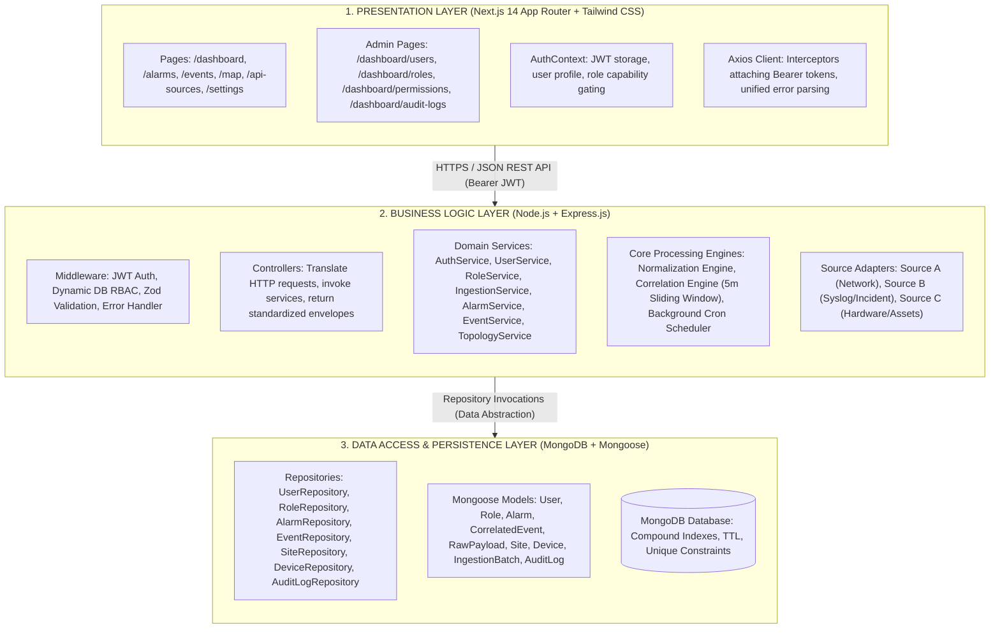
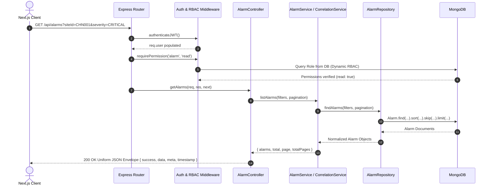
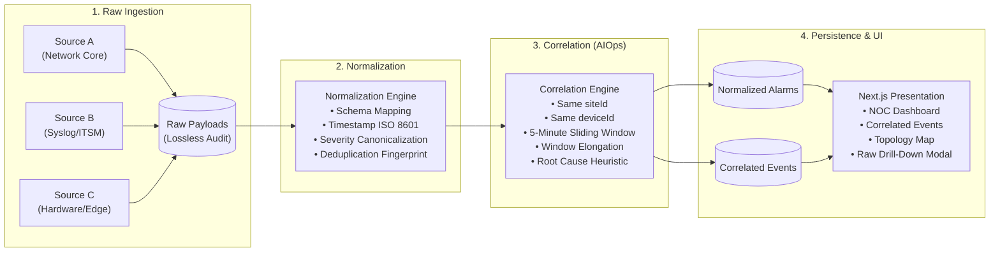

# App360 – Technical Presentation, Architecture Walkthrough & Defense Guide

> **Target Audience:** Engineering Leadership, Principal Architects, Take-Home Evaluation Committee  
> **Candidate Role:** Full Stack Engineer (App360 Take-Home Assignment)  
> **System Name:** App360 Carrier-Grade NOC & Alarm Management Portal  
> **Status:** Production-Ready & Verified (69/69 Unit/Integration Tests Passed, 28/28 E2E Live Checks Passed)

---

## Presentation Agenda

1. [Executive Summary & Architectural Paradigm](#1-executive-summary--architectural-paradigm)
2. [Three-Tier Layer Segregation & Responsibilities](#2-three-tier-layer-segregation--responsibilities)
3. [Controller-Service-Repository Request Lifecycle](#3-controller-service-repository-request-lifecycle)
4. [Ingestion → Normalization → Correlation → Presentation Pipeline](#4-ingestion--normalization--correlation--presentation-pipeline)
5. [Rule-Based Alarm Correlation Engine (AIOps Concept)](#5-rule-based-alarm-correlation-engine-aiops-concept)
6. [Dynamic Database-Driven RBAC & 9-Module Matrix](#6-dynamic-database-driven-rbac--9-module-matrix)
7. [Geospatial Topology & Interactive Carrier Map](#7-geospatial-topology--interactive-carrier-map)
8. [Live Demonstration Script (Step-by-Step NOC Tour)](#8-live-demonstration-script-step-by-step-noc-tour)
9. [Optional Bonus: App360 Awareness & Future-Ready Evolution](#9-optional-bonus-app360-awareness--future-ready-evolution)
10. [Zoho Catalyst Deployment Architecture](#10-zoho-catalyst-deployment-architecture)
11. [Interview Defense: Anticipated Questions & Architectural Defense](#11-interview-defense-anticipated-questions--architectural-defense)

---

## 1. Executive Summary & Architectural Paradigm

In modern telecommunications and enterprise network operations, cascading infrastructure failures trigger **"alarm storms"** — thousands of redundant alarms flood the Network Operations Center (NOC), blinding engineers to the true root cause.

**App360** solves this challenge by delivering:
- **Zero Frontend-to-Database Coupling:** Next.js communicates strictly via authenticated REST APIs.
- **Heterogeneous Ingestion:** Adapters ingest telemetry across multiple disparate formats (Source A, Source B, Source C) into an immutable raw payload store.
- **Canonical Schema Normalization:** Standardizes arbitrary timestamps, proprietary severity names (`P1`, `CRITICAL`, `MAJOR`), and device formats.
- **Rule-Based AIOps Correlation:** Groups alarms matching **Same Site + Same Device within a Sliding 5-Minute Window**, computing dynamic noise reduction metrics.
- **Dynamic Database-Driven RBAC:** Configurable 9-module $\times$ 4-action matrix evaluated at runtime in MongoDB without requiring server restarts.

---

## 2. Three-Tier Layer Segregation & Responsibilities

### Strict Layer Invariants Enforced:
1. **Presentation Layer:** Zero direct MongoDB, Mongoose, or database driver code. Gated UI elements are cosmetic only; true authorization is enforced at the Express API layer.
2. **Business Logic Layer:** Controllers do not execute database queries or business rules; they delegate to Domain Services. Services orchestrate transactions and invoke Repositories.
3. **Data Layer:** Encapsulates Mongoose query logic, indexing strategies, and sanitization (`passwordHash` with `select: false`).

---

## 3. Controller-Service-Repository Request Lifecycle

Every client request traverses a strict 4-step execution path:

---

## 4. Ingestion → Normalization → Correlation → Presentation Pipeline

### Noise Reduction Formula
$$\text{Noise Reduction \%} = \left( 1 - \frac{\text{Total Correlated Events}}{\text{Total Normalized Alarms}} \right) \times 100$$
*Example:* 100 incoming alarms compressed into 15 actionable incidents represents an **85% operational noise reduction**.

---

## 5. Rule-Based Alarm Correlation Engine (AIOps Concept)

### Mandatory Correlation Heuristics:
1. **Spatial Constraint:** Alarms must share identical `siteId`.
2. **Topological Constraint:** Alarms must share identical `deviceId`.
3. **Temporal Sliding Window:**
   $$\Delta t = |t_{\text{alarm}} - t_{\text{earliest}}| \le 300\text{ seconds (5 minutes)}$$
4. **Overlapping Window Behavior:** When an alarm arrives within 5 minutes of an existing event's `lastAlarmTime`, the event's time boundary extends:
   $$\text{lastAlarmTime} = \max(\text{event.lastAlarmTime}, t_{\text{alarm}})$$
5. **Severity Escalation:** Event severity automatically assumes the **highest severity** among its constituent alarms:
   $$\text{Severity Hierarchy: } \text{CRITICAL} > \text{MAJOR} > \text{MINOR} > \text{WARNING} > \text{INFO}$$
6. **Root Cause Heuristic:** The chronologically earliest alarm (`firstAlarmTime`) that triggered the cascading failure is flagged as `isRootCause: true`.
7. **Lossless Drill-Down:** Each normalized alarm preserves `rawPayloadId`. Engineers clicking an incident can drill down into individual alarms, and from individual alarms into the exact wire JSON payload received from the vendor.

---

## 6. Dynamic Database-Driven RBAC & 9-Module Matrix

Unlike static hardcoded systems (`if (user.role === 'admin')`), App360 evaluates permissions dynamically against MongoDB documents:

### The 9 Configurable System Modules:
1. **`dashboard`**: Telemetry KPIs, noise reduction percentage, severity distribution.
2. **`alarm`**: Normalized alarm directory and lossless wire payload inspection.
3. **`event`**: Correlated incident tracking, acknowledgement, and resolution workflows.
4. **`map`**: Geospatial network topology, site health markers, and node inspection.
5. **`api`**: Multi-source ingestion control, manual trigger, and polling telemetry.
6. **`user`**: Operator directory, user provisioning, and status toggle.
7. **`role`**: Security role definition, assigned user counts, and custom capability creation.
8. **`settings`**: Runtime parameters, ingestion thresholds, and engine toggles.
9. **`audit`**: Immutable administrative action trail with state diff snapshots.

### Action Primitives Supported:
$$\text{Actions} = \{ \text{create}, \text{read}, \text{update}, \text{delete} \}$$

### Default Role Blueprint:
| Module | ADMIN | ENGINEER | VIEWER |
|---|:---:|:---:|:---:|
| `dashboard` | `C, R, U, D` | `R` | `R` |
| `alarm` | `C, R, U, D` | `R, U` | `R` |
| `event` | `C, R, U, D` | `R, U` | `R` |
| `map` | `C, R, U, D` | `R` | `R` |
| `api` | `C, R, U, D` | `R` | `None` |
| `user` | `C, R, U, D` | `None` | `None` |
| `role` | `C, R, U, D` | `None` | `None` |
| `settings` | `C, R, U, D` | `R` | `None` |
| `audit` | `C, R, U, D` | `None` | `None` |

### Zero-Restart Dynamic Enforcement:
When an administrator modifies a permission in `/dashboard/permissions`, the change is written to MongoDB immediately. On the very next HTTP request, Express middleware queries the database role, enforcing the updated boundary instantly with **zero server downtime**.

---

## 7. Geospatial Topology & Interactive Carrier Map

- **Carrier Grade Leaflet Integration:** Built with `react-leaflet` and Leaflet 1.9 using OpenStreetMap cartography.
- **Dynamic Site Severity Rollups:**
  - 🔴 **Red Marker (CRITICAL):** Site contains at least one active CRITICAL alarm.
  - 🟡 **Amber Marker (MAJOR):** Site contains MAJOR alarms without CRITICAL alarms.
  - 🔵 **Blue Marker (MINOR / WARNING):** Site has non-critical warnings.
  - 🟢 **Green Marker (NORMAL):** All devices operational, zero active alarms.
- **Interactive Node Inspection:** Clicking a site marker queries `GET /api/topology/sites/:id`, dynamically rendering site details, geographic coordinates, associated hardware devices, and live active alarms.
- **Client-Side Filtering:** NOC operators can filter sites in real-time by severity, region, or active status.

---

## 8. Live Demonstration Script (Step-by-Step NOC Tour)

Follow this 5-minute presentation script during your evaluation:

### Step 1: Sign in as System Administrator
1. Navigate to `http://localhost:3000/login`.
2. Click **ADMIN** in the Dev Profiles palette (`admin@app360.internal` / `Admin@360!`).
3. Click **Sign In to NOC Console**.
4. **Talking Point:** *"Notice the centralized command dashboard calculating real-time metrics directly from MongoDB: active alarms, correlated incidents, and dynamic noise reduction percentage calculated from real database records."*

### Step 2: Ingestion & Alarm Normalization Pipeline
1. Navigate to **API Sources** (`/api-sources`).
2. Show the three heterogeneous mock sources (Source A: Network, Source B: Syslog, Source C: Assets).
3. Click **Trigger Ingestion Batch**.
4. **Talking Point:** *"Notice how incoming payloads with different field keys, date formats, and severity strings are normalized into a single canonical format while preserving raw payloads for audit."*

### Step 3: Alarm Correlation & Raw Drill-Down
1. Navigate to **Correlated Events** (`/events`).
2. Point out an incident with multiple constituent alarms:
   - Point out the **Site ID**, **Device ID**, and **5-Minute Window**.
   - Show how the **Root Cause** alarm is highlighted.
3. Click an incident to drill down into constituent alarms.
4. Click **View Raw Wire Payload** on an alarm:
   - **Talking Point:** *"Engineers have complete lossless audit traceability from high-level incidents down to the exact wire JSON payload."*

### Step 4: Interactive Network Topology Map
1. Navigate to **Network Map** (`/map`).
2. Point out the regional sites across India (Chennai, Bangalore, Mumbai, Delhi, Hyderabad).
3. Filter by **CRITICAL** severity; show markers filter dynamically.
4. Click a node to open the live inspection popup.

### Step 5: Dynamic RBAC & User Administration
1. Navigate to **Users** (`/dashboard/users`).
2. Demonstrate account status toggle (deactivate an operator).
3. Attempt to deactivate the last Admin: show the system guard strictly blocking lockout (`CANNOT_DEACTIVATE_LAST_ADMIN`).
4. Navigate to **Permission Matrix** (`/dashboard/permissions`).
5. Modify a permission for the **VIEWER** role (e.g., grant `api:read`).
6. Sign out and sign in as `viewer.test@app360.internal` (`Password123!`): show that the Viewer instantly gains access to API sources without restarting the server.
7. Navigate to **Audit Logs** (`/dashboard/audit-logs`) as Admin: show the full chronological record capturing actor name, action, and JSON diffs of previous versus updated state.

---

## 9. Optional Bonus: App360 Awareness & Future-Ready Evolution

### 1. Scaling to High-Throughput Telemetry (SNMP, Kafka, gRPC)
- **Current State:** REST-based periodic polling via `node-cron`.
- **Scaling Architecture:** Replace periodic polling with an **Apache Kafka / RabbitMQ event streaming bus**. Telemetry collectors (SNMP traps, Syslog daemons, NetFlow probes) publish raw telemetry to Kafka topics (`telemetry.raw`). Worker consumers run the Normalization Engine and push canonical alarms to a partitioned stream (`telemetry.normalized`).

### 2. Evolution of Alarm Correlation (AIOps 2.0)
- **Graph Neural Networks (GNNs):** Instead of flat `siteId` + `deviceId` matching, model network topology as a directed dependency graph. A failure at a core router automatically correlates with dependent edge switches downstream.
- **Transformer-Based Log Summarization:** Integrate a compact LLM (Gemini Nano) to read unstructured syslog messages and generate plain-English incident summaries for NOC dispatchers.
- **Predictive Anomaly Detection:** Train Holt-Winters or autoencoder models on metric streams (CPU, packet drop, optical power) to trigger predictive alerts before a hard failure occurs.

---

## 10. Zoho Catalyst Deployment Architecture

App360 is packaged for deployment onto **Zoho Catalyst**:
- **Catalyst AppSail Container:** Hosts the containerized Node.js/Express API backend (`backend`) with automated health checks and environment configuration.
- **Catalyst Web Client Hosting:** Serves Next.js optimized production assets globally via Catalyst CDN.
- **Configuration File:** Documented in [`catalyst.json`](../catalyst.json) and [`docs/zoho-catalyst-deployment.md`](./zoho-catalyst-deployment.md).

---

## 11. Interview Defense: Anticipated Questions & Architectural Defense

### Q1: "Why did you choose a Controller-Service-Repository pattern instead of writing queries directly in routes?"
> **Defense:** *"In carrier-grade systems like App360, mixing HTTP parsing, business rules, and database queries in route handlers creates tight coupling, makes unit testing difficult, and prevents reuse. By enforcing strict separation, our `CorrelationService` can be invoked from both the REST controller and the automated background cron scheduler without duplicating a single line of logic. Furthermore, repositories isolate Mongoose syntax, allowing persistence technology to evolve without touching business logic."*

### Q2: "How does your sliding window handle overlapping alarms?"
> **Defense:** *"Our engine implements an elongated sliding window algorithm. When a new alarm arrives matching the same site and device, we check if its timestamp falls within 5 minutes of the event's earliest alarm or current window. If an alarm arrives at $T+4\text{m}$, it joins the incident and extends the active boundary to $T+4\text{m}$. However, if a subsequent alarm arrives at $T+10\text{m}$ (exceeding the 5-minute delta from the latest alarm), the engine recognizes the gap and spawns a new independent incident."*

### Q3: "How does your dynamic RBAC avoid server restarts?"
> **Defense:** *"Instead of compiling permissions into JWT tokens or application memory at startup, our Express `rbac.middleware.js` queries the MongoDB `roles` collection dynamically using the authenticated user's `roleId`. When an administrator updates a role's permissions matrix, the new document is persisted immediately. The very next incoming request reads the updated permission matrix directly from the database, delivering instant runtime enforcement."*

### Q4: "How do you protect against administrator lockout?"
> **Defense:** *"In `UserService.js`, both the `updateUserStatus` method (deactivation) and `updateUser` method (role reassignment) run an atomic aggregation query counting active users assigned to the `ADMIN` role. If $\text{activeAdmins} \le 1$, the operation throws HTTP 400 (`CANNOT_DEACTIVATE_LAST_ADMIN` or `CANNOT_DEMOTE_LAST_ADMIN`), guaranteeing that the system can never be rendered orphan."*

### Q5: "How is raw data preserved for audit compliance?"
> **Defense:** *"Before any normalization or correlation occurs, `IngestionService` creates an immutable document in the `raw_alarm_payloads` collection holding the raw, unedited JSON wire payload, HTTP headers, and ingestion timestamp. The normalized alarm stores a foreign key `rawPayloadId`. This delivers complete forensic drill-down without polluting the normalized operational indexes."*
